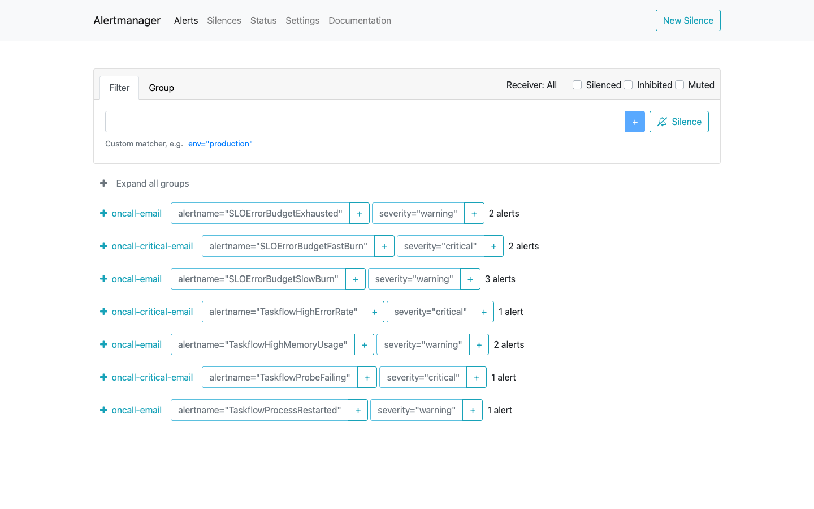
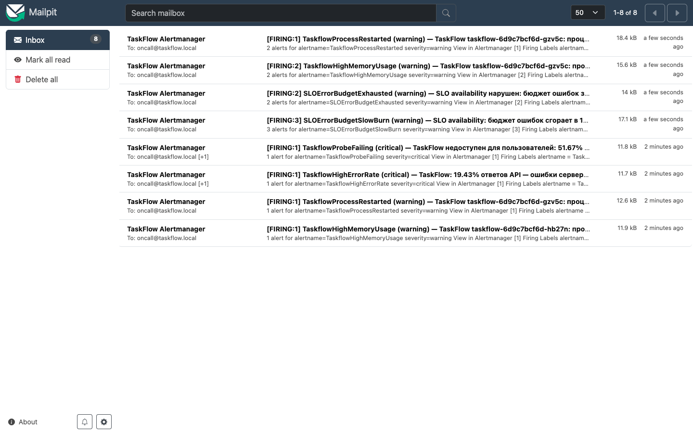
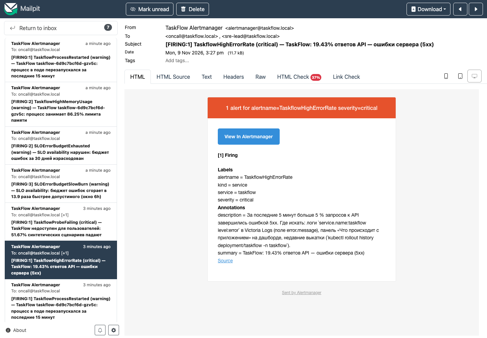
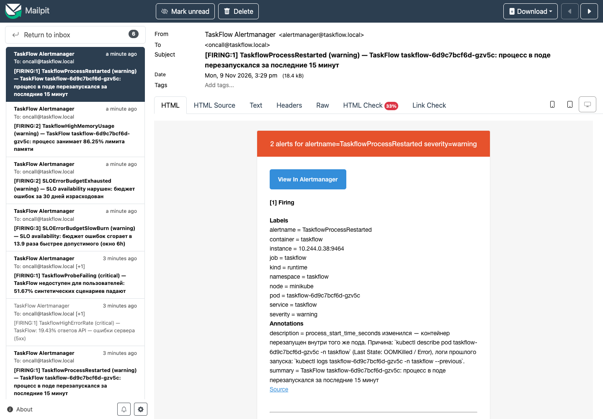
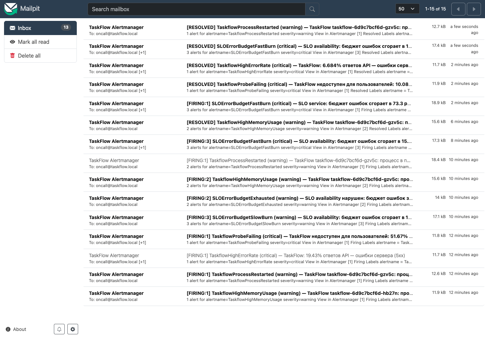

# Отчёт: алерты для TaskFlow (minikube)

## 1. Стек

| Компонент | Версия | Роль |
|---|---|---|
| **TaskFlow** | 2.0.0 (образ `taskflow:2.0`) | приложение из ДЗ №1–5: **Python 3.13 + FastAPI**, REST API проектов и задач; метрики — `prometheus_client` |
| PostgreSQL + postgres-exporter | 17 / v0.20.1 | база приложения и её метрики (ДЗ №4) |
| taskflow-prober | 2.0.0 | синтетические сценарии пользователя (ДЗ №5) |
| VictoriaMetrics single, vmagent | v1.154.0 | хранение и сбор метрик (ДЗ №4) |
| **vmalert** | v1.154.0, чарт `vm/victoria-metrics-alert` 0.51.0 | вычисляет правила SLO (ДЗ №5) и алерты ДЗ №6, отправляет сработавшие в Alertmanager |
| **Alertmanager** | v0.34.1 (`prom/alertmanager`) | группировка, подавление, маршрутизация и рассылка уведомлений |
| **Mailpit** | v1.32.0 (`axllent/mailpit`) | почтовый ящик дежурного: SMTP-сервер с веб-интерфейсом внутри кластера |
| Grafana | 13.2.4 | дашборд SLI/SLO/SLA (ДЗ №5) |
| vmalert-tool | v1.154.0 | юнит-тесты правил |

**Приложение переписано на Python.** Задание просит алерты на метрики рантайма «актуатора
spring/python», поэтому TaskFlow (и пробер) теперь на Python: FastAPI + `prometheus_client`. Метрики
HTTP и бизнес-метрики сохранили имена и метки ДЗ №4 (`http_request_duration_seconds{method, route,
status_code}`, `taskflow_*`), поэтому правила SLO из ДЗ №5 работают без изменений. Метрики рантайма —
готовые коллекторы `prometheus_client`: `process_*` (CPU, память, дескрипторы, время старта) и
`python_gc_*` (сборщик мусора). Исходники — [../app](../app) и [../prober](../prober).

Состав архива:

| Путь | Назначение |
|---|---|
| `k8s/monitoring/rules/alerts.yaml` | **алерты ДЗ №6**: группы `taskflow-service` и `taskflow-runtime` |
| `k8s/monitoring/rules/slo-rules.yaml` | правила и алерты SLO из ДЗ №5 |
| `k8s/monitoring/rules/tests/alerts.test.yaml` | юнит-тесты алертов ДЗ №6 (8 сценариев) |
| `k8s/monitoring/40-alertmanager.yaml` | **конфигурация Alertmanager**: маршруты, получатели, подавление, шаблон темы письма |
| `k8s/monitoring/41-mailpit.yaml` | Mailpit — почта дежурного |
| `k8s/monitoring/vmalert-values.yaml` | vmalert: `notifier.url` → Alertmanager |
| `k8s/monitoring/*.yaml`, `k8s/app/*.yaml` | остальной стек ДЗ №4–5 |
| `scripts/` | деплой, туннели, сбои (`fault.sh`), демонстрация (`alert-demo.sh`), тесты правил, скриншоты |
| `screenshots/` | скриншоты (раздел 7) и журналы демонстрации `demo-fire.log`, `demo-recover.log` |
| `app/`, `prober/` | исходники приложения и пробера с Dockerfile |

## 2. Какие алерты нужны

Алерт должен будить человека, только если нужно действовать, и сразу подсказывать, где искать.
Поэтому алерты TaskFlow устроены в три слоя:

| Слой | Вопрос | Алерты | Откуда |
|---|---|---|---|
| **Симптомы для пользователя (SLO)** | «Пользователи страдают настолько, что под угрозой обязательства?» | `SLOErrorBudgetFastBurn`, `SLOErrorBudgetSlowBurn`, `SLOErrorBudgetExhausted`, `SLABreached`, `SLOProberDown` | ДЗ №5 |
| **Сервис** | «Что именно сломалось?» | `TaskflowHighErrorRate`, `TaskflowHighLatency`, `TaskflowProbeFailing`, `TaskflowDatabaseDown`, `TaskflowMetricsDown` | ДЗ №6 |
| **Рантайм Python** | «Что происходит с процессом?» — риск, который ещё не стал аварией | `TaskflowHighMemoryUsage`, `TaskflowProcessRestarted` | ДЗ №6 |

Алерты SLO — главные: они срабатывают по реальному ущербу для пользователей, но говорят только
«плохо», а не «почему». Алерты сервиса указывают на компонент (API, база, путь пользователя, сбор
метрик), алерты рантайма — на состояние процесса, которое скоро станет проблемой.

Принципы, общие для всех:

* **Уровни.** `critical` — пользователи страдают сейчас, будить дежурного (письмо на два адреса,
  напоминание раз в 30 минут); `warning` — риск, разобраться в рабочее время (письмо дежурному,
  напоминание раз в 4 часа).
* **Устойчивость к шуму.** Доли и перцентили — в окне 5 минут, плюс пауза `for`: одиночный
  всплеск (выкатка пода, секундный обрыв) не будит человека.
* **Каждый алерт отвечает «где искать».** В `description` — конкретные запросы и команды:
  LogsQL для Victoria Logs, `kubectl describe pod`, `kubectl logs --previous`, панель дашборда.
* **Без дублей.** Alertmanager группирует алерты по имени и уровню (десять реплик с одной
  проблемой — одно письмо) и подавляет следствия, когда известна причина (раздел 5).

Что сознательно **не** алертится:

* **CPU.** Лимита CPU у контейнера нет, а высокая загрузка сама по себе не проблема: если она
  мешает пользователям, это покажет `TaskflowHighLatency`.
* **Частота сборок мусора** (`python_gc_collections_total`). Полезна при разборе утечки, но
  действовать по ней нечего; вместо неё — алерт на итог, память процесса.
* **Бизнес-метрики** («за час не создано ни одной задачи»). На учебном трафике такой алерт горел бы
  постоянно; в настоящем сервисе с ровной нагрузкой он имеет смысл и записывается так же.

## 3. Алерты на метрики сервиса

Файл [`k8s/monitoring/rules/alerts.yaml`](k8s/monitoring/rules/alerts.yaml), группа `taskflow-service`,
вычисляется раз в 30 секунд. `api` ниже — запросы к API, те же, что в SLI ДЗ №5:
`{job="taskflow", route=~"/api/(projects|tasks).*|unmatched"}` (без проб kubelet и статики).

| Алерт | Условие | `for` | Уровень | Почему так |
|---|---|---|---|---|
| **TaskflowHighErrorRate** | доля ответов 5xx среди ответов API за 5 мин > 5 % | 2m | critical | каждый двадцатый запрос падает — заметно пользователям; в 10 раз выше бюджета SLO availability (0,5 %), месячный бюджет кончится за 3 дня |
| **TaskflowHighLatency** | p95 времени ответа API за 5 мин > 250 мс | 3m | warning | порог — тот же, что у SLI latency (граница корзины гистограммы); сервис отвечает, просто медленно — не авария |
| **TaskflowProbeFailing** | доля неуспешных запусков проб за 5 мин > 10 % | 2m | critical | взгляд клиента: видит отказ, даже когда запросы не доходят до приложения и серверные метрики молчат; 10 % — это 2–3 упавших сценария из ~24 в минуту, а не случайный один |
| **TaskflowDatabaseDown** | `pg_up < 1` или метрик базы нет совсем | 1m | critical | единственная зависимость, без которой не работает ни один запрос к данным; `absent()` ловит случай, когда под БД удалён |
| **TaskflowMetricsDown** | ни одна реплика TaskFlow не отдаёт `/metrics` (`absent(up == 1)`) | 2m | critical | без метрик все остальные алерты слепы — «тишина» не должна выглядеть как «всё хорошо» |

```yaml
- alert: TaskflowHighErrorRate
  expr: |
    sum(rate(http_request_duration_seconds_count{job="taskflow", route=~"/api/(projects|tasks).*|unmatched", status_code=~"5.."}[5m]))
      / sum(rate(http_request_duration_seconds_count{job="taskflow", route=~"/api/(projects|tasks).*|unmatched"}[5m]))
    > 0.05
  for: 2m
  labels: { severity: critical, service: taskflow, kind: service }
  annotations:
    summary: 'TaskFlow: {{ $value | humanizePercentage }} ответов API — ошибки сервера (5xx)'
    description: >-
      … Где искать: логи `service.name:taskflow level:error` в Victoria Logs (поле error.message),
      панель «Что происходит с приложением» на дашборде, недавние выкатки (`kubectl rollout history …`).
```

Чем алерты сервиса отличаются от алертов SLO на те же метрики: алерт SLO availability горит, когда
сгорает **бюджет** (относительно цели 99,5 % и окна 30 дней), а `TaskflowHighErrorRate` — когда
ошибок **много прямо сейчас**, независимо от того, сколько бюджета осталось. Первый говорит о
последствиях, второй — о месте поломки.

## 4. Алерты на метрики рантайма Python

Группа `taskflow-runtime`. Метрики — готовые коллекторы `prometheus_client` (ProcessCollector),
их отдаёт каждая реплика на `/metrics`.

| Алерт | Метрика | Условие | `for` | Уровень |
|---|---|---|---|---|
| **TaskflowHighMemoryUsage** | `process_resident_memory_bytes` | память процесса (RSS) > 80 % лимита контейнера 256 MiB | 2m | warning |
| **TaskflowProcessRestarted** | `process_start_time_seconds` | время старта процесса в поде за 15 мин менялось (разница > 1 с) | — | warning |

```yaml
- alert: TaskflowHighMemoryUsage
  expr: max by (pod) (process_resident_memory_bytes{job="taskflow"}) / (256 * 1024 * 1024) > 0.8
  for: 2m
  labels: { severity: warning, service: taskflow, kind: runtime }

- alert: TaskflowProcessRestarted
  expr: |
    max_over_time(process_start_time_seconds{job="taskflow"}[15m])
      - min_over_time(process_start_time_seconds{job="taskflow"}[15m])
    > 1
  labels: { severity: warning, service: taskflow, kind: runtime }
```

**Почему память.** На 100 % лимита ядро убивает процесс (OOMKilled), запросы этой реплики
обрываются. 80 % — момент, когда ещё есть время разобраться: утечка (рост без спада), слишком
большой ответ, неудачный релиз. Алерт — по каждому поду отдельно (`max by (pod)`): утечка обычно
видна сначала на одной реплике. Лимит 256 MiB записан в выражении: в кластере нет kube-state-metrics,
из которого его можно было бы взять (см. раздел 9).

**Почему перезапуски.** Если процесс в поде перезапустился — он упал (необработанная ошибка,
OOMKilled) или его убил kubelet по liveness. Пользователь при этом может ничего не заметить
(вторая реплика взяла трафик), но повторяющиеся перезапуски — это авария, которая ещё не
случилась. Пауза `for` не нужна: перезапуск — событие, а не состояние; алерт горит 15 минут
(окно), письмо уходит сразу.

Два подводных камня, найденных при отладке этого правила:

1. **Не `changes()`.** Очевидное `changes(process_start_time_seconds[15m]) > 0` в MetricsQL
   засчитывает «изменение» и для ряда моложе окна: каждый новый под при обычной выкатке давал бы
   ложный алерт. Это поймал юнит-тест (ожидалось «1 перезапуск», получилось 2). Разница
   `max_over_time − min_over_time` у нового пода равна нулю — у него одно время старта; тест
   «новый под при выкатке — алерт не горит» это закрепляет.
2. **Порог 1 с, а не 0.** В кластере алерт загорелся для пода, процесс которого не перезапускался:
   минимум и максимум времени старта отличались на одну десятимиллионную секунды
   (`1794225591.89` и `1794225591.8899999`) — VictoriaMetrics хранит значения с ограниченной
   точностью, и метка времени порядка 1,8·10⁹ «дрожит» в последних знаках. Настоящий перезапуск
   сдвигает время старта как минимум на секунды, поэтому условие — `> 1`.

## 5. Конфигурация: vmalert → Alertmanager → почта

```
vmalert (правила)  ──-notifier.url──►  Alertmanager  ──SMTP :1025──►  Mailpit (почта дежурного)
   раз в 30 с                           группирует,                     веб-интерфейс :8025
   pending → firing                     подавляет, маршрутизирует
```

**vmalert** ([`vmalert-values.yaml`](k8s/monitoring/vmalert-values.yaml)) — в ДЗ №5 уведомления
отключались флагом `notifier.blackhole`, теперь:

```yaml
extraArgs:
  rule: [/config/*.yaml]                                     # slo-rules.yaml + alerts.yaml из ConfigMap
  notifier.url: http://alertmanager.monitoring.svc:9093     # сработавшие алерты — в Alertmanager
  external.url: http://127.0.0.1:8880                       # ссылки «Source» в письмах — на UI vmalert
```

**Alertmanager** ([`40-alertmanager.yaml`](k8s/monitoring/40-alertmanager.yaml)):

```yaml
global:
  smtp_smarthost: mailpit.monitoring.svc:1025
  smtp_from: 'TaskFlow Alertmanager <alertmanager@taskflow.local>'
  smtp_require_tls: false
route:
  receiver: oncall-email
  group_by: [alertname, severity]   # одно письмо на алерт и уровень, а не на каждую реплику
  group_wait: 30s
  group_interval: 2m
  repeat_interval: 4h
  routes:
    - matchers: ['severity="critical"']
      receiver: oncall-critical-email
      group_wait: 10s
      repeat_interval: 30m
receivers:
  - name: oncall-email               # warning — дежурному
    email_configs:
      - to: oncall@taskflow.local
        send_resolved: true
        headers: { Subject: '{{ template "taskflow.subject" . }}' }
  - name: oncall-critical-email      # critical — дежурному и руководителю
    email_configs:
      - to: oncall@taskflow.local, sre-lead@taskflow.local
        send_resolved: true
        headers: { Subject: '{{ template "taskflow.subject" . }}' }
inhibit_rules:
  # БД лежит — ошибки API, медленные ответы и падающие пробы — следствие: одно письмо о причине.
  - source_matchers: ['alertname="TaskflowDatabaseDown"']
    target_matchers: ['alertname=~"TaskflowHighErrorRate|TaskflowHighLatency|TaskflowProbeFailing"']
  # Горит critical-версия алерта — warning-версия того же алерта не нужна.
  - source_matchers: ['severity="critical"']
    target_matchers: ['severity="warning"']
    equal: [alertname, slo]
```

Тема письма — свой шаблон: статус, алерт, уровень и `summary` первого горящего алерта группы,
например `[FIRING:1] TaskflowHighErrorRate (critical) — TaskFlow: 19.43% ответов API — ошибки сервера (5xx)`.
Дежурный понимает суть, не открывая письмо; стандартная тема склеивает все общие метки
(`instance`, `node`, `container`…) и читается плохо.

**Mailpit** ([`41-mailpit.yaml`](k8s/monitoring/41-mailpit.yaml)) — тестовый почтовый сервер:
принимает письма по SMTP и показывает их в веб-интерфейсе. Внешние аккаунты и токены не нужны;
в настоящей команде меняется только раздел `receivers` (корпоративная почта, Telegram, Slack,
PagerDuty), правила и маршруты остаются.

## 6. Проверка правил юнит-тестами

`scripts/test-rules.sh` прогоняет `vmalert-tool unittest` на синтетических рядах — кластер не нужен.
Для ДЗ №6 — [`alerts.test.yaml`](k8s/monitoring/rules/tests/alerts.test.yaml), 8 сценариев:

| Сценарий | Что проверяется |
|---|---|
| норма | ни один из 7 алертов не горит; 503 от проб kubelet в долю ошибок не входят |
| ошибки 20 % | на 11-й минуте `TaskflowHighErrorRate` ещё нет (пауза `for`), на 20-й — горят он и `TaskflowProbeFailing`, тексты аннотаций с подставленными значениями |
| медленные ответы | половина ответов 250–500 мс → p95 ≈ 475 мс → `TaskflowHighLatency` |
| БД недоступна | `pg_up = 0` → `TaskflowDatabaseDown` |
| метрики пропали | `up = 0` у единственной реплики → `TaskflowMetricsDown` |
| утечка памяти | 230 MiB у одной реплики из двух → `TaskflowHighMemoryUsage` только для неё |
| перезапуск процесса | время старта сменилось → алерт горит, через 15 минут гаснет |
| новый под при выкатке | ряд появился в середине окна → алерта **нет** |

```
$ scripts/test-rules.sh
Unit Testing:  alerts.test.yaml       SUCCESS
Unit Testing:  sla.test.yaml          SUCCESS
Unit Testing:  slo-rules.test.yaml    SUCCESS
```

## 7. Демонстрация: как сработали алерты

**Изменения приложения.** К сбоям ДЗ №5 (`FAULT_ERROR_RATE`, `FAULT_LATENCY_MS`) добавлен
`FAULT_MEMORY_MB` ([`taskflow/faults.py`](../app/taskflow/faults.py)): при старте процесс занимает
столько мегабайт резидентной памяти — имитация утечки. Текущее значение видно метрикой
`taskflow_fault_injection_memory_bytes`. Перезапуск процесса — `scripts/fault.sh restart`: SIGTERM
процессу Python в одном поде, kubelet запускает контейнер заново в том же поде.

**Сценарий** (`scripts/alert-demo.sh fire`, журнал — [`screenshots/demo-fire.log`](screenshots/demo-fire.log)):

1. очистить ящик Mailpit;
2. выкатить ревизию с дефектом: `FAULT_ERROR_RATE=0.2` (20 % запросов к БД падают) и
   `FAULT_MEMORY_MB=160` (каждая реплика — около 220 MiB из 256);
3. через минуту перезапустить процесс в одном поде;
4. дождаться, пока все четыре ожидаемых алерта перейдут в `firing`.

| Время | Событие |
|---|---|
| 15:21:27 | ревизия с дефектом выкачена (обе реплики) |
| 15:22:00 | `TaskflowHighMemoryUsage` — pending для обоих подов (86 % лимита) |
| 15:22:27 | процесс в поде `gzv5c` перезапущен |
| 15:23:00 | `TaskflowProcessRestarted` — сразу firing (без паузы `for`); `TaskflowProbeFailing` — pending |
| 15:23:30 | `TaskflowHighErrorRate` — pending (доля 5xx в окне 5 мин перевалила за 5 %) |
| 15:23:49 | письмо: `[FIRING:1] TaskflowProcessRestarted (warning)` |
| 15:24:00 | `TaskflowHighMemoryUsage` — firing (прошло 2 мин паузы `for`) |
| 15:24:49 | письмо: `[FIRING:2] TaskflowHighMemoryUsage (warning)` — оба пода в одном письме |
| 15:25:00 | `TaskflowProbeFailing` — firing |
| 15:25:30 | `TaskflowHighErrorRate` — firing |
| 15:25:57 | письмо: `[FIRING:1] TaskflowProbeFailing (critical)` — на два адреса |
| 15:26:27 | письмо: `[FIRING:1] TaskflowHighErrorRate (critical)` — на два адреса |

Параллельно, как и положено, загорелись алерты SLO из ДЗ №5 — бюджет ошибок availability и probes
сгорает в десятки раз быстрее допустимого (`SLOErrorBudgetFastBurn`, `SlowBurn`, `Exhausted`): слой
«симптомов» и слой «причин» сработали вместе.

От включения сбоя до письма — 2,5–5 минут: окно 5 минут должно набрать достаточно плохих
событий, затем пауза `for`, затем ожидание группы в Alertmanager (`group_wait`). Ещё ~30–60 с
добавляет сам vmalert: правила вычисляются раз в 30 с и с отставанием на 30 с
(`-rule.evalDelay` по умолчанию), чтобы в VictoriaMetrics успели дойти последние точки.

> В первом прогоне в теме письма попадал `summary` уже погасшего алерта из прошлой серии (группа в
> Alertmanager хранит и погасшие). Шаблон исправлен — теперь в теме первый **горящий** алерт;
> после перезапуска Alertmanager письма по горящим алертам пришли заново (15:27–15:29), их и
> видно на скриншотах ниже.

**Правила в vmalert** — обе группы ДЗ №6 с выражениями, паузами `for`, метками и состоянием:


**pending → firing.** Через 3 минуты после выкатки: перезапуск уже `firing` (значение — на сколько
секунд сдвинулось время старта, 74,3), память, пробы и ошибки ещё досиживают паузу `for`; ниже —
алерты SLO:


Все алерты ДЗ №6 в `firing`:


**Alertmanager** — группы по алерту и уровню и получатель каждой (`oncall-email` или
`oncall-critical-email`):



**Уведомления** — ящик дежурного в Mailpit: критичные письма ушли на `oncall@` и `sre-lead@`
(«[+1]»), предупреждения — только дежурному:



Письмо о критичном алерте сервиса — метки, описание с подсказкой, где искать, ссылки на
Alertmanager и на алерт в vmalert («Source»):



Письмо об алерте рантайма — перезапуск процесса в поде `gzv5c`:



**Восстановление** (`scripts/alert-demo.sh recover`, журнал — [`screenshots/demo-recover.log`](screenshots/demo-recover.log)):
сбои сняты новой ревизией, алерты гаснут, Alertmanager присылает письма `RESOLVED`:

| Время | Событие |
|---|---|
| 15:31:18 | ревизия без сбоев выкачена: новые поды, балласта и ошибок нет |
| 15:33:49 | `[RESOLVED] TaskflowHighMemoryUsage` — старые поды удалены, их ряды пропали |
| 15:37:57 | `[RESOLVED] TaskflowHighErrorRate`, `[RESOLVED] TaskflowProbeFailing` — окно 5 минут очистилось от ошибок |
| 15:39:49 | `[RESOLVED] TaskflowProcessRestarted` — перезапуск в 15:22:27 вышел из окна 15 минут |

Алерты на доли гаснут не сразу после устранения: окно 5 минут ещё держит плохие события, поэтому
`RESOLVED` по ошибкам пришёл через 6 минут. В теме письма `RESOLVED` — последнее значение,
которое алерт видел, пока горел (6,7 % — уже ниже порога, но окно было ещё «грязным»).



## 8. Как воспроизвести

```bash
minikube start --driver=docker --container-runtime=docker
scripts/build-image.sh            # taskflow:2.0 и taskflow-prober:2.0
scripts/deploy.sh                 # весь стек, ~5 минут
scripts/test-rules.sh             # юнит-тесты правил
scripts/port-forward.sh           # отдельный терминал
scripts/alert-demo.sh fire        # сбои → алерты → письма (~6 минут)
open http://127.0.0.1:8880/vmalert/alerts http://127.0.0.1:9093 http://127.0.0.1:8025
scripts/alert-demo.sh recover     # снять сбои, дождаться RESOLVED
```

## 9. Ограничения

* **Почта не уходит наружу.** Mailpit — тестовый ящик внутри кластера. Для настоящих уведомлений
  меняется только `receivers` в конфигурации Alertmanager.
* **Лимит памяти записан в выражении** (256 MiB). Без kube-state-metrics в кластере нет ряда с
  лимитами контейнеров; при изменении лимита в манифесте правило нужно поправить вместе с ним.
* **Перезапуски видны только внутри пода.** Под, который не смог стартовать вовсе
  (CrashLoopBackOff до первого скрейпа), метрик не отдаёт — это ловит `TaskflowMetricsDown`, а
  точную причину показали бы метрики kube-state-metrics (`kube_pod_container_status_restarts_total`).
* **Состояние Alertmanager — в `emptyDir`.** Тишины (silences) и журнал отправленных уведомлений
  теряются при пересоздании пода, после этого горящие алерты присылаются заново. Для прода —
  постоянный том и несколько реплик в кластере.
* **Алерты SLO на коротком демо шумят.** История рядов SLO — часы, а не 30 дней, поэтому RBSLO
  «исчерпан» после первого же сбоя (подробно — в отчёте ДЗ №5).
