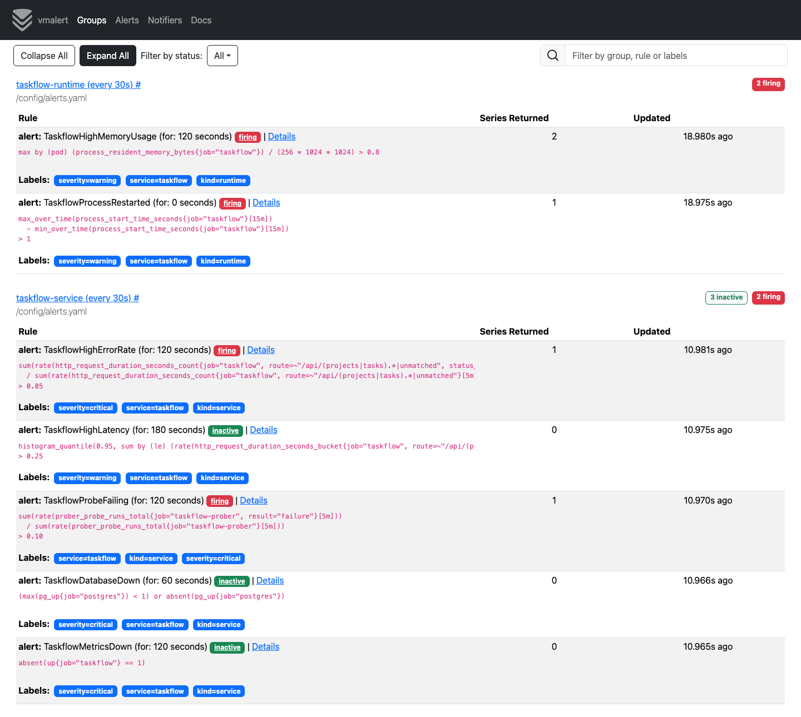
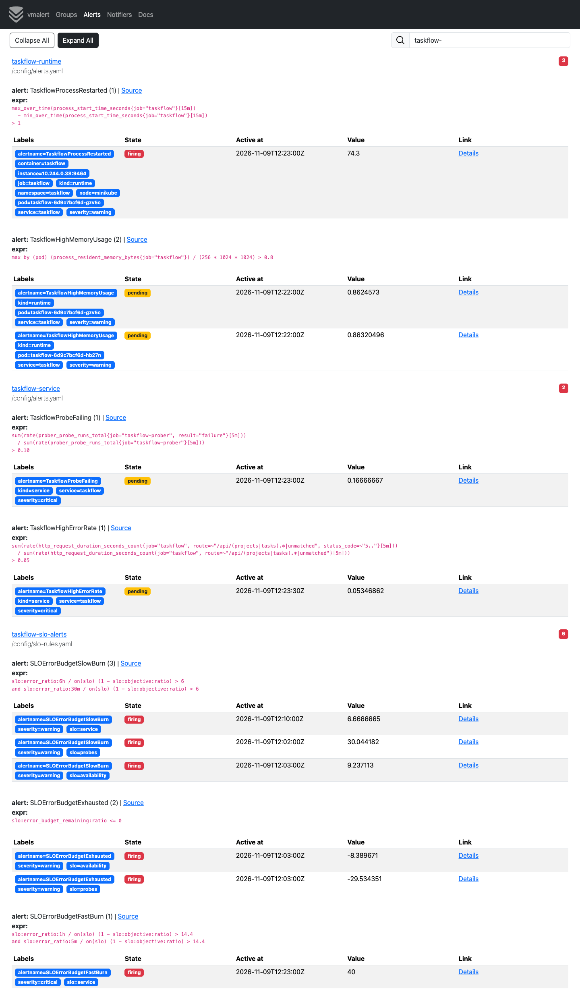
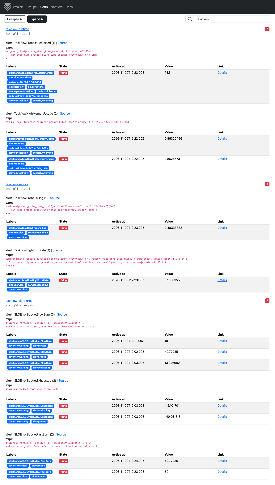

# Отчёт по ДЗ 6: алерты

В этом задании я настроила алерты для TaskFlow: на метрики сервиса и на метрики рантайма Python.
Алерты считает vmalert, Alertmanager группирует их и отправляет письма. Вместо настоящей почты —
Mailpit: тестовый почтовый сервер внутри кластера с веб-интерфейсом.

Правила лежат в [k8s/monitoring/rules/alerts.yaml](k8s/monitoring/rules/alerts.yaml), настройки
Alertmanager — в [k8s/monitoring/40-alertmanager.yaml](k8s/monitoring/40-alertmanager.yaml).
Как запустить — в [README.md](README.md).

## Как я думала про алерты

Алерт должен будить человека, только если нужно что-то делать, и сразу подсказывать, где искать.
Поэтому у меня три слоя:

1. **Симптомы** — алерты на SLO из ДЗ 5. Говорят, что пользователи страдают настолько, что под
   угрозой обещания, но не говорят почему.
2. **Сервис** — что именно сломалось: API, скорость ответа, база, сбор метрик.
3. **Рантайм Python** — то, что ещё не авария, но скоро ею станет: память и перезапуски.

Уровни такие: `critical` — пользователи страдают прямо сейчас, письмо дежурному и руководителю;
`warning` — разобраться в рабочее время, письмо только дежурному.

У каждого условия есть пауза `for`: алерт загорается, только если проблема держится какое-то время.
Так одиночный всплеск, например перезапуск пода при выкатке, никого не разбудит. В описании каждого
алерта написано, где искать причину: какой запрос сделать в логах, какую команду `kubectl` выполнить,
какую панель открыть.

Что я специально не стала алертить:

- **CPU** — высокая загрузка сама по себе не проблема. Если она мешает пользователям, сработает
  алерт на медленные ответы.
- **Частоту сборки мусора** — по ней нечего делать. Вместо неё есть алерт на итог, то есть на память.
- **Бизнес-метрики** вроде «за час не создано ни одной задачи» — на учебном трафике такой алерт
  горел бы постоянно.

## Алерты на метрики сервиса

| Алерт | Когда срабатывает | `for` | Уровень |
|---|---|---|---|
| `TaskflowHighErrorRate` | больше 5 % ответов API за 5 минут — ошибки 5xx | 2m | critical |
| `TaskflowHighLatency` | p95 времени ответа за 5 минут больше 250 мс, то есть больше 5 % ответов медленнее 250 мс | 3m | warning |
| `TaskflowProbeFailing` | больше 10 % проверок пробера за 5 минут упали | 2m | critical |
| `TaskflowDatabaseDown` | база недоступна или её метрик нет совсем | 1m | critical |
| `TaskflowMetricsDown` | ни одна реплика приложения не отдаёт метрики | 2m | critical |

Пороги я выбирала так: 5 % ошибок — это каждый двадцатый запрос, такое пользователи точно заметят.
250 мс — тот же порог, что в SLO из ДЗ 5. 10 % проверок — это 2–3 упавших сценария в минуту, а не
один случайный. Отдельный алерт на пропавшие метрики нужен затем, чтобы тишина не выглядела как
«всё хорошо».

```yaml
- alert: TaskflowHighErrorRate
  expr: |
    sum(rate(http_request_duration_seconds_count{job="taskflow", route=~"/api/(projects|tasks).*|unmatched", status_code=~"5.."}[5m]))
      / sum(rate(http_request_duration_seconds_count{job="taskflow", route=~"/api/(projects|tasks).*|unmatched"}[5m]))
    > 0.05
  for: 2m
  labels: { severity: critical }
```

Чем этот алерт отличается от алерта SLO на те же ошибки: алерт SLO срабатывает, когда сгорает
бюджет ошибок за месяц, а этот — когда ошибок много прямо сейчас, сколько бы бюджета ни осталось.

## Алерты на рантайм Python

| Алерт | Метрика | Когда срабатывает | `for` |
|---|---|---|---|
| `TaskflowHighMemoryUsage` | `process_resident_memory_bytes` | процесс занял больше 80 % лимита памяти (256 МБ) | 2m |
| `TaskflowProcessRestarted` | `process_start_time_seconds` | за последние 15 минут процесс перезапускался | — |

```yaml
- alert: TaskflowHighMemoryUsage
  expr: max by (pod) (process_resident_memory_bytes{job="taskflow"}) / (256 * 1024 * 1024) > 0.8
  for: 2m

- alert: TaskflowProcessRestarted
  expr: |
    max_over_time(process_start_time_seconds{job="taskflow"}[15m])
      - min_over_time(process_start_time_seconds{job="taskflow"}[15m])
    > 1
```

**Память:** если процесс дойдёт до 100 % лимита, Kubernetes его убьёт, и запросы оборвутся. 80 % —
момент, когда ещё есть время разобраться. Алерт считается для каждого пода отдельно, потому что
утечка обычно сначала видна на одной реплике.

**Перезапуски:** если процесс перезапустился, значит он упал или его убили. Пользователи могут
этого не заметить, но повторяющиеся перезапуски — это авария, которая ещё не случилась. Паузы `for`
здесь нет: перезапуск — это событие, а не состояние.

При отладке этого правила я наткнулась на две проблемы:

1. Сначала я написала `changes(process_start_time_seconds[15m]) > 0`, но тогда алерт загорался на
   каждый новый под при обычной выкатке. Это поймал юнит-тест. Разница максимума и минимума у нового
   пода равна нулю, поэтому с ней такой проблемы нет.
2. Порог стоит 1 секунда, а не 0, потому что время старта хранится с небольшой погрешностью и
   «дрожит» в последних знаках. Из-за этого был ложный алерт. Настоящий перезапуск сдвигает время
   на секунды.

## Куда уходят алерты

```
vmalert  →  Alertmanager  →  Mailpit (почта дежурного)
```

Главное из настроек Alertmanager:

```yaml
route:
  receiver: oncall-email
  group_by: [alertname, severity]   # одно письмо на алерт, а не на каждую реплику
  repeat_interval: 4h
  routes:
    - matchers: ['severity="critical"']
      receiver: oncall-critical-email   # critical — дежурному и руководителю
      repeat_interval: 30m
inhibit_rules:
  # Упала база — ошибки API, медленные ответы и упавшие проверки уже не важны, это следствие.
  - source_matchers: ['alertname="TaskflowDatabaseDown"']
    target_matchers: ['alertname=~"TaskflowHighErrorRate|TaskflowHighLatency|TaskflowProbeFailing"']
  # Горит critical-версия алерта — warning-версия того же алерта не нужна.
  - source_matchers: ['severity="critical"']
    target_matchers: ['severity="warning"']
    equal: [alertname, slo]
```

Тему письма я сделала понятной, чтобы суть была видна, не открывая его:
`[FIRING:1] TaskflowHighErrorRate (critical) — TaskFlow: 19.43% ответов API — ошибки сервера (5xx)`.

## Проверка юнит-тестами

Правила проверены `vmalert-tool` на восьми сценариях: норма, 20 % ошибок, медленные ответы, база
недоступна, метрики пропали, утечка памяти на одной реплике, перезапуск процесса и новый под при
выкатке (алерт на перезапуск гореть не должен). Все тесты проходят.

```
$ scripts/test-rules.sh
Unit Testing:  alerts.test.yaml       SUCCESS
Unit Testing:  sla.test.yaml          SUCCESS
Unit Testing:  slo-rules.test.yaml    SUCCESS
```

## Как сработали алерты

Чтобы проверить алерты вживую, я выкатила версию приложения с поломками: 20 % запросов к базе
падают, и каждая реплика при старте занимает лишние 160 МБ памяти (как будто утечка). Через минуту
я перезапустила процесс в одном поде. Всё это делает скрипт `scripts/alert-demo.sh fire`, его
журнал — [demo-fire.log](screenshots/demo-fire.log).

| Время | Что произошло |
|---|---|
| 15:21:27 | выкатила версию с поломками |
| 15:22:27 | перезапустила процесс в одном поде |
| 15:23:00 | `TaskflowProcessRestarted` сразу загорелся, паузы у него нет |
| 15:23:49 | письмо про перезапуск |
| 15:24:00 | `TaskflowHighMemoryUsage` загорелся после двух минут паузы |
| 15:24:49 | письмо про память, оба пода в одном письме |
| 15:25:00 | загорелся `TaskflowProbeFailing` |
| 15:25:30 | загорелся `TaskflowHighErrorRate` |
| 15:25:57 | письмо про пробер, на два адреса |
| 15:26:27 | письмо про ошибки, на два адреса |

От поломки до письма прошло от 2,5 до 5 минут: окну в 5 минут нужно набрать плохих событий, потом
идёт пауза `for`, потом Alertmanager немного ждёт, чтобы собрать алерты в группу. Вместе с этими
алертами загорелись и алерты SLO из ДЗ 5, то есть сработали оба слоя: и симптомы, и причины.

Правила в vmalert:



Через 3 минуты: алерт на перезапуск уже горит, остальные ещё ждут окончания паузы (pending):



Все алерты горят:



Alertmanager собрал их в группы и выбрал получателя для каждой:


Письма в Mailpit. Критичные ушли дежурному и руководителю, предупреждения — только дежурному:


Письмо про ошибки сервера: метки, описание и подсказка, где искать причину:


Письмо про перезапуск процесса:


Потом я убрала поломки (`scripts/alert-demo.sh recover`, журнал —
[demo-recover.log](screenshots/demo-recover.log)). Алерты погасли, и пришли письма `RESOLVED`.
Алерт на ошибки погас не сразу, а через 6 минут: окно в 5 минут ещё помнило ошибки.


## Что стоит знать

- Письма никуда наружу не уходят: Mailpit — тестовый ящик. Для настоящей почты, Telegram или Slack
  нужно поменять только раздел `receivers` в Alertmanager.
- Лимит памяти 256 МБ записан прямо в правиле: в кластере нет kube-state-metrics, откуда его можно
  было бы взять. Если поменять лимит в манифесте, правило нужно поправить тоже.
- Состояние Alertmanager не сохраняется на диск. После перезапуска пода он заново пришлёт письма по
  горящим алертам.
