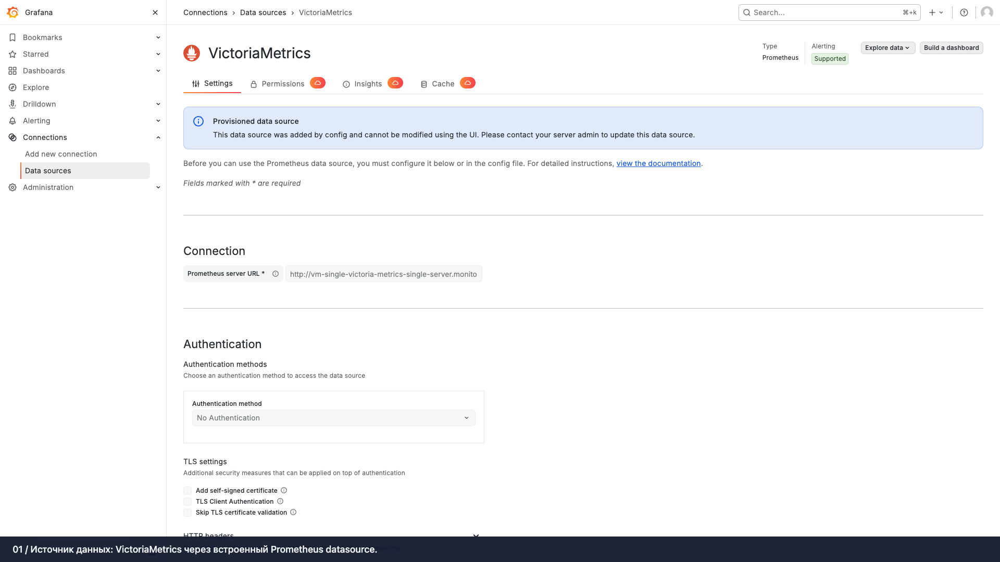
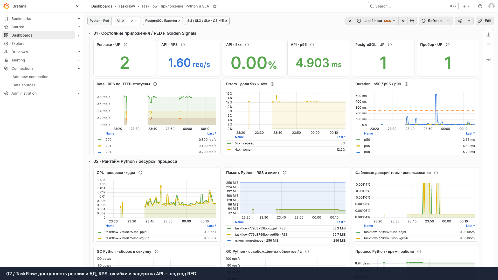
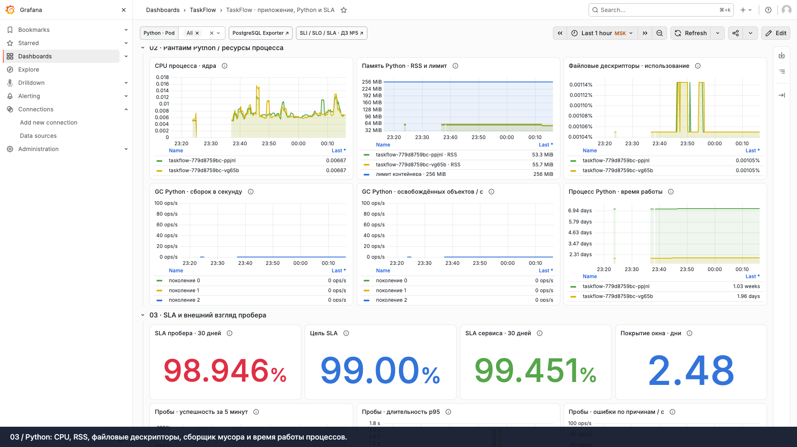
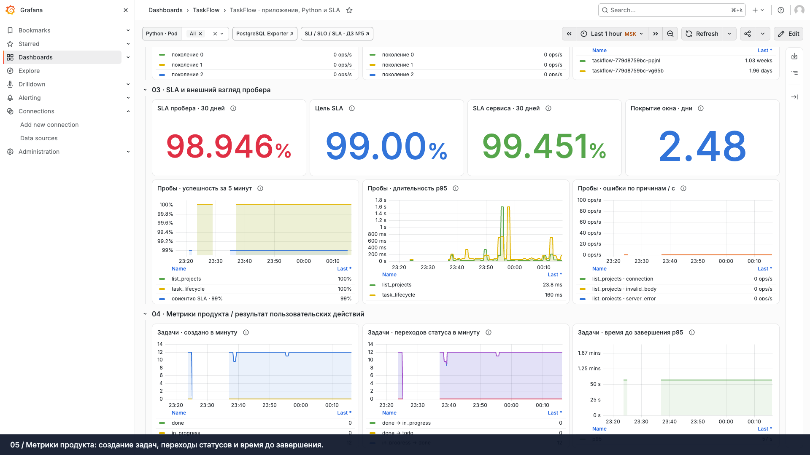
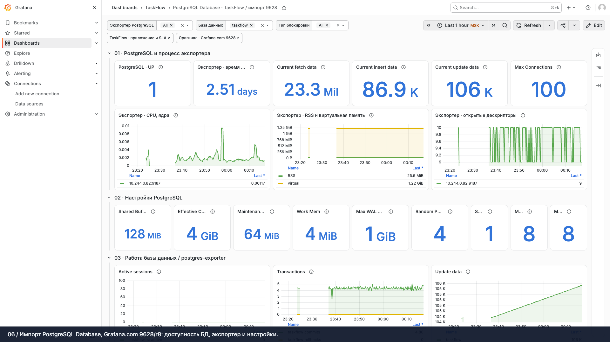
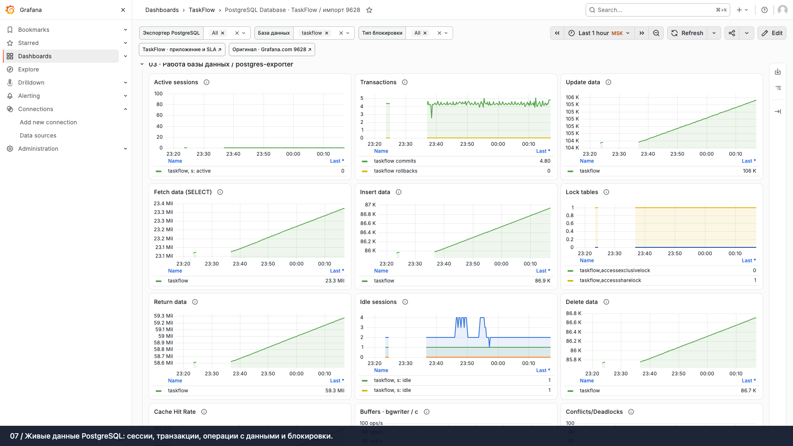

# Дашборды Grafana для TaskFlow

## Результат

В minikube запущена Grafana. В ней настроен источник VictoriaMetrics и два дашборда:

| Дашборд | Содержимое | Экспорт из Grafana |
|---|---|---|
| **TaskFlow · приложение, Python и SLA** | 25 панелей: состояние, RED, рантайм Python, SLA пробера и бизнес-метрики | [taskflow-overview.json](dashboards/taskflow-overview.json) |
| **PostgreSQL Database · TaskFlow / импорт 9628** | 32 панели импортированного дашборда PostgreSQL Exporter | [postgresql-exporter.json](dashboards/postgresql-exporter.json) |

Скриншоты сделаны с работающего стенда. [Скринкаст MP4](screencast/screencast.mp4) показывает источник данных, оба дашборда и переключение между их разделами. Это запись браузера с реальными запросами к Grafana; подписи внизу объясняют показанный раздел. Карта разделов — [chapters.json](screencast/chapters.json).

Видео: **1 минута 16 секунд, 1920×1080, H.264**, без звука, с поясняющими подписями.

## 1. Стенд и источник данных

| Компонент | Версия / расположение | Назначение |
|---|---|---|
| TaskFlow | Python 3.13 + FastAPI, образ `taskflow:2.0`, namespace `taskflow`, 2 реплики | API проектов и задач, HTTP- и бизнес-метрики |
| prometheus_client | 0.22.1 | OpenMetrics, готовые ProcessCollector и GCCollector |
| PostgreSQL | 17, под `db-0` | База данных приложения |
| postgres-exporter | v0.20.1, sidecar в поде БД, порт 9187 | Статистика PostgreSQL |
| taskflow-prober | namespace `monitoring`, порт 9464 | Внешние пользовательские сценарии `list_projects` и `task_lifecycle` |
| vmagent / VictoriaMetrics single | v1.154.0, namespace `monitoring` | Сбор каждые 15 секунд и хранение метрик |
| vmalert | v1.154.0 | Recording rules SLI/SLO/SLA из ДЗ №5 |
| Grafana | 13.2.4, Helm `grafana-community/grafana` 14.1.0 | Визуализация, namespace `monitoring` |

Используется единый datasource **VictoriaMetrics**, тип **Prometheus**, UID `victoriametrics`, URL:

```text
http://vm-single-victoria-metrics-single-server.monitoring.svc:8428
```

Данные запрашивает сервер Grafana, поэтому доступ к VictoriaMetrics не зависит от браузера. Источник задан через provisioning в [grafana-values.yaml](k8s/monitoring/grafana-values.yaml). vmagent обнаруживает поды по аннотациям `prometheus.io/*`; метки `job` разделяют `taskflow`, `taskflow-prober` и `postgres`. Prometheus datasource обращается к совместимому API VictoriaMetrics.



Состояние подов сохранено в [cluster-pods.txt](evidence/cluster-pods.txt). Значения и результат health check datasource — в [dashboard-queries.json](evidence/dashboard-queries.json).

## 2. Панели приложения: RED и Golden Signals

Верхний ряд отвечает на вопросы «сервис доступен?» и «есть ли сейчас проблема?». Следом идут графики для оценки масштаба и времени начала изменения.

| Панель / группа | Метрики и расчёт | Почему выбрано |
|---|---|---|
| Реплики · UP | `sum(up{job="taskflow"})`, ожидается 2 | Видно, с каких реплик собираются метрики; HTTP-доступность независимо проверяется пробером |
| API · RPS | `sum(rate(http_request_duration_seconds_count[…]))` | **RED Rate / Golden Signal traffic**: объём пользовательского трафика |
| API · 5xx | число ответов 5xx / все ответы API | **RED Errors**: доля отказов сервера, а не просто число ошибок при росте нагрузки |
| API · p95 | `histogram_quantile(0.95, sum by(le)(rate(…_bucket[…])))` | **RED Duration / Golden Signal latency**: задержка, заметная пользователям |
| PostgreSQL · UP | `min(pg_up{job="postgres"})` | Доступность основной зависимости приложения |
| Пробер · UP | `min(up{job="taskflow-prober"})` | Контроль источника измерения SLA |
| RPS по HTTP-статусам | скорость счётчика по `status_code` | Различаем успешные запросы, ошибки клиента и ошибки сервера |
| Доля 5xx и 4xx | отдельные временные ряды процентов | Ошибки клиента не смешиваются с отказами сервера |
| p50 / p95 / p99 | перцентили общей гистограммы | Видно распределение задержки и её длинный хвост |

Для HTTP выбраны только маршруты `/api/projects…`, `/api/tasks…` и `unmatched`. `/api/health`, `/api/ready` и статика исключены: частые пробы kubelet не должны улучшать статистику пользовательского API.

Сначала считается `rate()` по отдельным счётчикам, затем `sum()` по репликам: так корректно обрабатываются сбросы счётчиков. Для адаптивных графиков используется `$__rate_interval`, не меньше четырёх интервалов скрейпа. Перцентили вычисляются из суммарных bucket, а не усреднением перцентилей реплик.

Если 5xx ещё ни разу не было, числитель подставляет ноль только при существующем ряде общего трафика. При отсутствии трафика процент не определён; отсутствие наблюдений не подменяется успешностью 100%.

Ориентир p95 — 250 мс из ДЗ №5. Доля 5xx подсвечивается жёлтым от 1%, красным от 5%. Во время съёмки работали 2 реплики, шло около 1,6 запроса/с, текущая доля 5xx была 0%. Ненулевая доля 4xx ожидаема: сценарий пробера проверяет, что удалённая задача возвращает 404.



## 3. Детализация рантайма Python и ресурсы

| Панель | Запрос / метрика | Что помогает понять |
|---|---|---|
| CPU процесса · ядра | `rate(process_cpu_seconds_total[…])` по подам | **USE utilization**: сколько CPU потребляет каждая реплика |
| Память Python · RSS и лимит | `process_resident_memory_bytes`, ориентир 256 MiB | Рост памяти и приближение к ограничению контейнера |
| Файловые дескрипторы | `process_open_fds / process_max_fds` | Использование ограниченного ресурса: риск отказов открытия файлов и соединений |
| GC · сборок в секунду | `rate(python_gc_collections_total[…])` по поколениям | Активность сборщика мусора для объяснения CPU и памяти |
| GC · освобождённых объектов / с | `rate(python_gc_objects_collected_total[…])` | Сопоставление освобождения объектов с ростом RSS |
| Время работы процесса | `time() - process_start_time_seconds` | Перезапуски при разборе выкаток, падений и OOM |

Переменная **Python · Pod** позволяет выбрать реплику для этого раздела. Верхние метрики API остаются метриками сервиса целиком. CPU показан в ядрах: у контейнера нет CPU limit, поэтому процент квоты не вычисляется. RSS — память процесса, а не вся память cgroup; лимит 256 MiB взят из манифеста и должен изменяться вместе с ним.

Подход USE и Golden Signal saturation здесь раскрываются через использование ресурсов и близость к их пределам. Метрик очереди запросов, CPU throttling и полного потребления памяти cgroup в текущем экспорте нет; панели не выдают RSS или CPU utilization за прямое измерение длины очереди. Для этого потребовались бы дополнительные метрики приложения или контейнера.



Дополнительно три панели показывают создание задач, переходы статуса и p95 времени до завершения. Это события после успешного изменения данных в БД, поэтому они дополняют HTTP-метрики результатом действий пользователя. В учебном стенде значительную часть событий создаёт пробер. Его задачи завершаются очень быстро, поэтому p95 lead time ограничен шириной первой корзины бизнес-гистограммы и не заменяет HTTP latency.



## 4. Отдельная панель SLA пробера

Карточка **«SLA пробера · 30 дней»** показывает доступность по результатам синтетических сценариев. Источник — recording rules ДЗ №5:

```promql
1 - slo:error_ratio:30d{slo="probes"}
```

В правилах показатель вычисляется как:

```promql
1 - sum_over_time(slo:events_bad:increase1m{slo="probes"}[30d])
      / sum_over_time(slo:events_total:increase1m{slo="probes"}[30d])
```

Это доля успешных запусков среди всех наблюдавшихся запусков за окно, взвешенная числом событий. Сценарии ходят в приложение через Kubernetes Service как обычный клиент и видят ошибки соединения, некорректные ответы и сбои отдельных шагов.

Рядом показаны:

- **Цель SLA — 99%** из `sla:objective:ratio{slo="service"}`. Это внешний ориентир из ДЗ №5; внутренний SLO пробера строже — 99,5%.
- **SLA сервиса · 30 дней** — исходный TBSLA из ДЗ №5: `1 - slo:error_ratio:30d{slo="service"}`. Он использует хорошие минуты, а успешность пробера — успешные запуски; знаменатели различаются.
- **Покрытие окна · дни** — `count_over_time(slo:events_total:increase1m{slo="probes"}[30d]) / 1440`.
- Графики успешности проб за 5 минут, p95 длительности сценариев и ошибок по причинам.

При проверке накопленная успешность пробера составляла примерно **98,94%**, поэтому карточка красная относительно ориентира 99%. Текущие пробы успешны, но предыдущие сбои остаются в 30-дневном окне. SLA сервиса по исходной формуле составлял около **99,45%**. Красный результат отражает реальные накопленные данные и не является ошибкой панели.

Фактически накоплено около **2,48 наблюдаемых дней**, а не полный месяц. Для успешности пробера расчёт использует имеющиеся события. Исходная формула TBSLA сервиса делит зафиксированные плохие минуты на 43 200 минут окна и считает ненаблюдавшееся время хорошим — это сохранённая договорённость ДЗ №5, а не доказательство месячной непрерывной доступности. Покрытие вынесено на экран, чтобы это ограничение было видно.


## 5. Импорт PostgreSQL Exporter

Импортирован **[PostgreSQL Database, ID 9628, revision 8](https://grafana.com/grafana/dashboards/9628-postgresql-database/)** автора Lucas Estienne. Сохранены [неизменённый JSON](dashboards/upstream/postgresql-9628-r8.json), [данные об источнике и адаптации](evidence/postgresql-import-source.json) и [успешные ответы Grafana при импорте](evidence/dashboard-import.json).

Дашборд использует тот же datasource VictoriaMetrics и метрики sidecar postgres-exporter. Выбор базы по умолчанию — `taskflow`; переменные `instance`, `datname`, `mode` заполняются по реальным меткам. Видны сессии, транзакции commit/rollback, операции с кортежами, блокировки, cache hit ratio, bgwriter, конфликты, deadlocks и временные файлы.

Для работы с текущими версиями внесены изменения:

| Изменение | Причина |
|---|---|
| `graph` → `timeseries`, `singlestat` → `stat` | Исходник рассчитан на старую Grafana; использованы актуальные встроенные панели |
| Удалены фильтры `release` / `kubernetes_namespace`, добавлен `job="postgres"` | В vmagent другие метки Kubernetes service discovery |
| `pg_static` заменён на `pg_up`, время postmaster — на uptime экспортера с явной подписью | Исходные коллекторы не включены в текущей конфигурации |
| Память показывается как gauge, единицы tuple-счётчиков — количество | `rate()` от RSS и отображение числа кортежей в байтах давали неверную интерпретацию |
| В bgwriter оставлены доступные `buffers_alloc_total` и `buffers_clean_total` | В стенде PostgreSQL 17 набор метрик отличается от старого шаблона |
| Legacy checkpoint-панель заменена на время чтения/записи `blk_read_time` / `blk_write_time` | Эти метрики реально доступны; миллисекунды переведены в секунды |
| Убраны фильтры `!= 0` у счётчиков | Нулевые значения должны отображаться, когда ошибок или операций нет |

Панели **CPU, RSS, virtual memory и FD относятся к процессу postgres-exporter**, а не к самому PostgreSQL. Это явно указано в названиях и описаниях. Нули времени I/O при выключенном `track_io_timing` не означают физически нулевую задержку диска.






## 6. Проверка и воспроизведение

Проверка выполнена через API самой Grafana, а не только прямыми запросами в VictoriaMetrics:

- Health check datasource: **OK**, Prometheus API доступен.
- **67 запросов** двух дашбордов вернули конечные числовые значения; ошибок и пустых результатов — **0**.
- UID панелей уникальны, элементы сетки не перекрываются.
- Экспорты JSON получены обратно из Grafana через `GET /api/dashboards/uid/...`.
- Скриншоты и MP4 показывают оба дашборда на живом стенде; журнал записи содержит перечень разделов и ошибки запросов.
- После обновления Helm повторная проверка подтвердила работающий под Grafana и три JSON дашборда в ConfigMap: приложение, PostgreSQL и исходный SLI/SLO/SLA.

Доказательства: [проверка запросов](evidence/dashboard-queries.json), [импорт](evidence/dashboard-import.json), [состояние Kubernetes](evidence/cluster-pods.txt), [журнал видео](screencast/chapters.json).

Конфигурация Grafana — [grafana-values.yaml](k8s/monitoring/grafana-values.yaml), JSON provisioning — [k8s/monitoring/dashboards](k8s/monitoring/dashboards), команды повторного запуска и записи — в [README.md](README.md). Приложены входные манифесты приложения, PostgreSQL Exporter, vmagent, VictoriaMetrics и правила SLO.

Официальная инструкция установки: [Grafana Helm Charts](https://grafana.com/docs/grafana/latest/setup-grafana/installation/helm/). Для текущего стенда установка уже выполнена; `scripts/deploy.sh` обновляет конфигурацию через Helm и ConfigMap. Подготовленные JSON можно импортировать отдельно через интерфейс Grafana.
