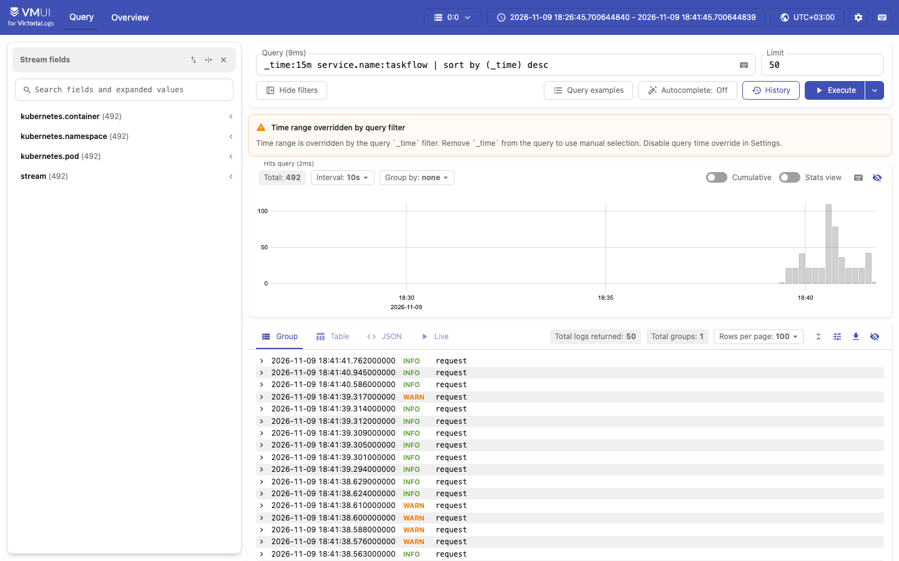
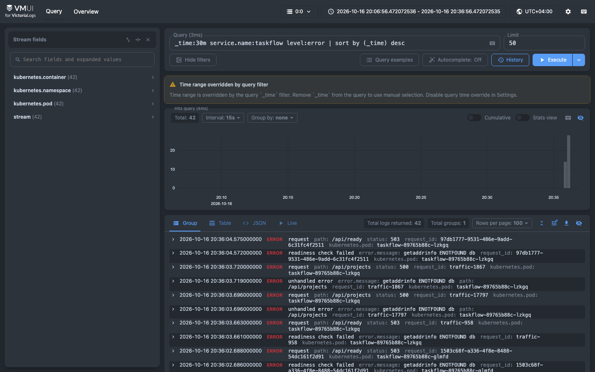
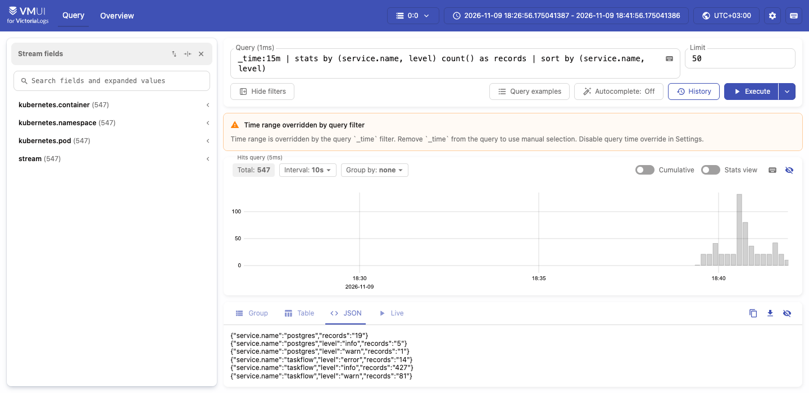
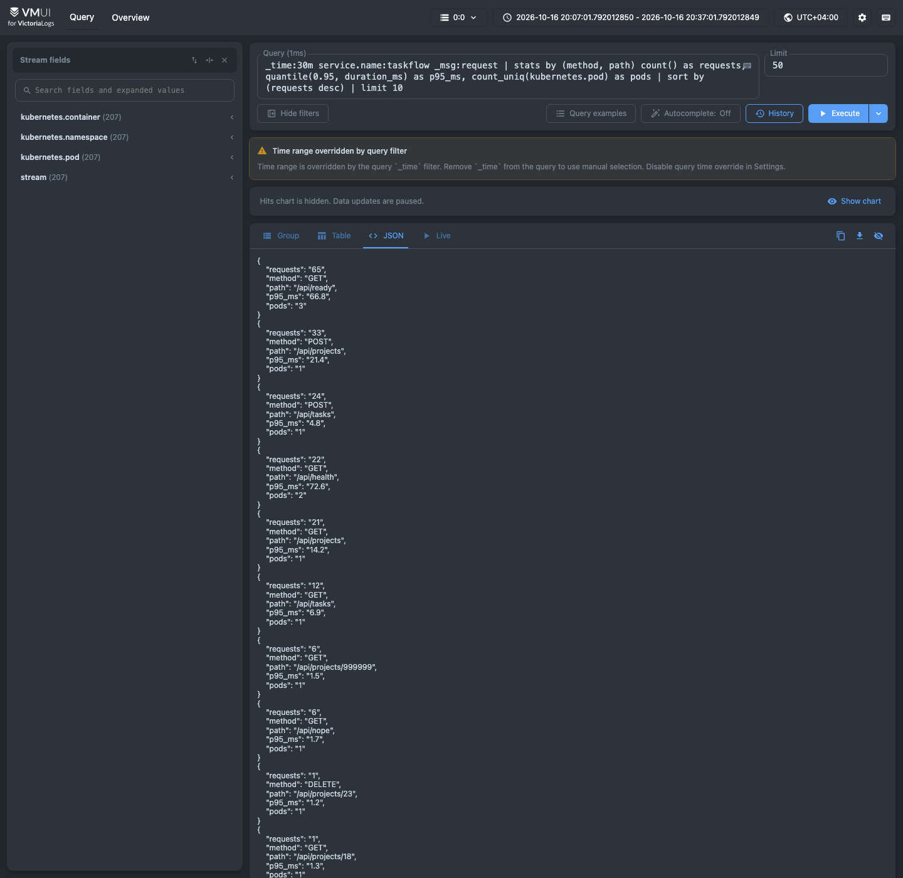
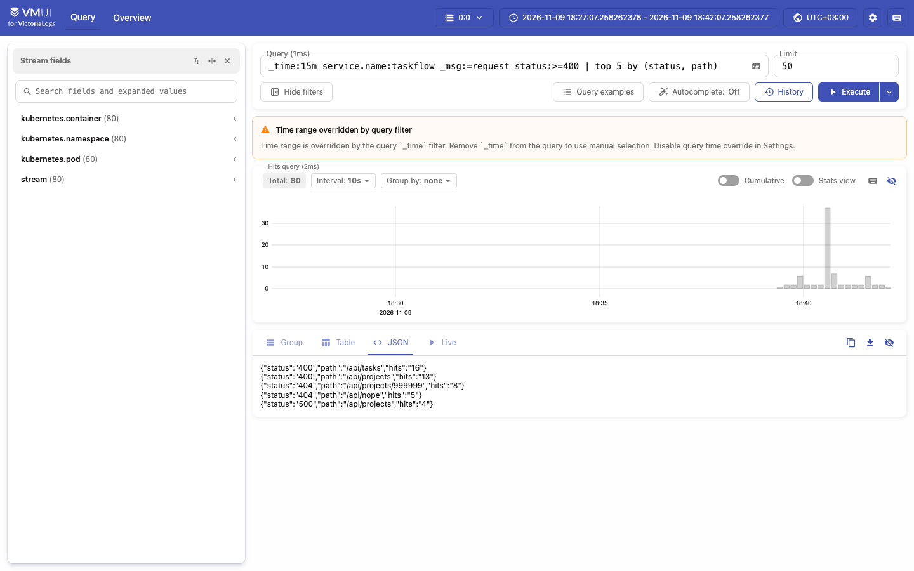
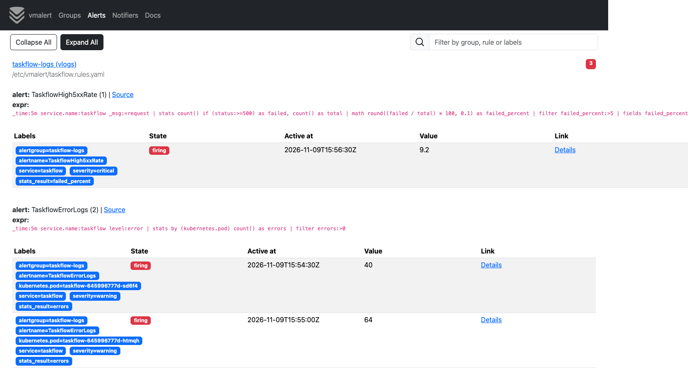
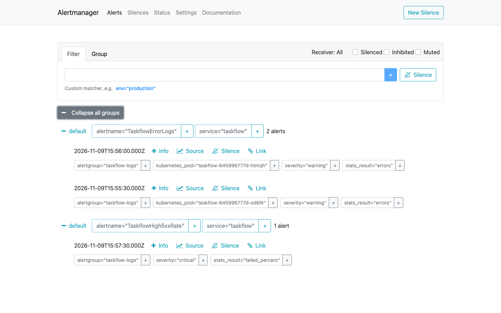

# Отчёт: логирование TaskFlow в Victoria Logs (minikube)

Приложение — **TaskFlow** из ДЗ №1 (Python 3.13 + FastAPI + PostgreSQL 17), развёрнутое в minikube
в ДЗ №2 (minikube v1.39.0, Kubernetes v1.37.0, драйвер и рантайм контейнеров `docker`). В этом задании
в тот же кластер добавлены **Victoria Logs v1.53.0** (single-node) и шиппер **Vector 0.59.0**
(DaemonSet), а приложение переведено на структурированные JSON-логи.

Состав архива:

| Путь | Назначение |
|---|---|
| `k8s/logging/*.yaml` | Victoria Logs (PVC + Deployment + Service), Vector (RBAC + ConfigMap + DaemonSet), namespace `logging`; бонус — vmalert и Alertmanager (`30-*`, `31-*`) |
| `k8s/app/*.yaml` | манифесты приложения из ДЗ №2: образ `taskflow:2.0` с JSON-логами, `LOG_LEVEL` в ConfigMap |
| `app/` | исходники приложения с `Dockerfile` (логи: `taskflow/logger.py`, `taskflow/middleware.py`, тесты); в репозитории — `../app` |
| `scripts/*.sh` | сборка образа, деплой, туннель до vmui, генерация трафика, запуск запросов, скриншоты, архив |
| `screenshots/*.png` | скриншоты vmui для каждого запроса из раздела 4; `06`/`07` — UI vmalert и Alertmanager (раздел 6) |
| `README.md` | инструкция по запуску |

## 1. Victoria Logs в кластере

Развёрнут single-node Victoria Logs обычными манифестами (`k8s/logging/10-victoria-logs.yaml`):

| Объект | Что делает |
|---|---|
| `Namespace logging` | отдельное пространство имён для хранилища и шиппера; удаляются и обновляются независимо от приложения |
| `PersistentVolumeClaim victoria-logs-data` (2 Gi) | данные переживают пересоздание пода; StorageClass по умолчанию `standard` |
| `Deployment victoria-logs` (1 реплика, `strategy: Recreate`) | один процесс `victoria-logs`; `Recreate`, потому что том ReadWriteOnce нельзя примонтировать второму поду во время RollingUpdate |
| `Service victoria-logs` (ClusterIP, 9428) | адрес для шиппера внутри кластера: `http://victoria-logs.logging.svc:9428` |

Флаги: `-retentionPeriod=7d` и `-retention.maxDiskSpaceUsageBytes=1GiB` (две независимые границы —
по времени и по месту), `-loggerFormat=json` (собственные логи Victoria Logs тоже JSON). Пробы
readiness/liveness — `GET /health`. Под запущен от непривилегированного пользователя с
`readOnlyRootFilesystem` и `capabilities: drop ALL`, то есть с теми же ограничениями, что и
приложение в профиле `restricted`.

Почему манифесты, а не Helm-чарт `victoria-logs-single`: для одного пода чарт не даёт ничего, чего
нет в 100 строках YAML, зато каждая настройка (том, флаги, пробы, securityContext) видна явно и
проверяется глазами; Helm в окружении не установлен, и тянуть его ради одного Deployment не хотелось.

Доступ снаружи кластера — `kubectl port-forward svc/victoria-logs -n logging 9428:9428`
(`scripts/port-forward.sh`), после чего vmui открывается на `http://127.0.0.1:9428/select/vmui/`,
а HTTP API — на `/select/logsql/query`.

```
$ kubectl get pods,pvc -n logging
NAME                                 READY   STATUS    RESTARTS   AGE
pod/alertmanager-56c6d8b8d6-6jg9r    1/1     Running   0          10m     ← бонус, раздел 6
pod/vector-5vl2n                     1/1     Running   0          92m
pod/victoria-logs-7854fb9845-629qc   1/1     Running   0          89m
pod/vmalert-6d998455d7-kz886         1/1     Running   0          3m46s   ← бонус, раздел 6
NAME                                       STATUS   VOLUME         CAPACITY   ACCESS MODES   STORAGECLASS
persistentvolumeclaim/victoria-logs-data   Bound    pvc-b21c8a5b   2Gi        RWO            standard
```

## 2. JSON-логи приложения

Все события приложения и миграций проходят через один модуль — JSON-логгер
[`taskflow/logger.py`](../app/taskflow/logger.py); access-лог пишет middleware
[`taskflow/middleware.py`](../app/taskflow/middleware.py). Сообщения библиотек (uvicorn)
перенаправлены в тот же поток, поэтому в stdout контейнера нет ни одной текстовой строки.
Схема записи по чек-листу семинара:

| Поле | Значение | Зачем |
|---|---|---|
| `timestamp` | `2026-10-16T16:15:06.394Z` | время события от самого приложения, RFC 3339, UTC; Victoria Logs берёт его как `_time` |
| `level` | `debug` / `info` / `warn` / `error` | порог задаётся `LOG_LEVEL` (ConfigMap); неизвестное значение — ошибка на старте |
| `message` | `request`, `unhandled error`, `migration applied`… | короткая неизменная формулировка события — по ней удобно фильтровать и считать; подробности — в отдельных полях |
| `service.name` | `taskflow` | `SERVICE_NAME`, по умолчанию `taskflow` |
| `service.version` | `2.0.0` | версия приложения (`taskflow.__version__`) — чтобы в логах было видно, какой релиз их писал |
| `deployment.environment` | `production` | `APP_ENV` |
| `request_id` | `traffic-29696`, UUID | из заголовка `X-Request-Id` или сгенерирован; возвращается клиенту тем же заголовком и попадает во **все** записи этого запроса |
| `method`, `path`, `query`, `status`, `duration_ms`, `client_ip` | access-лог | одна запись на запрос (по событию `close`, поэтому оборванные клиентом запросы тоже видны — `status: 499, aborted: true`; обрыв по ошибке сервера после начала ответа — `status: 500` с `error.*`). `path` — без строки запроса, чтобы `stats by (path)` не дробил `/api/tasks` по параметрам; сама строка запроса — в `query` (до 512 символов, поля нет, если её не было) |
| `error.message`, `error.stack`, `error.code` | у ошибок | `Error` раскладывается в плоские поля, вместо того чтобы терять `stack` при `JSON.stringify` |
| `component` | `migrate` | у логов init-контейнера миграций |

Решения, которые стоит проговорить:

* **Уровень access-лога зависит от статуса**: 5xx → `error` (наша вина), 4xx → `warn` (ошибка клиента),
  остальное → `info`. Поэтому запрос `level:error` сразу показывает и запросы, закончившиеся 500/503,
  и причину рядом (запись `unhandled error` с тем же `request_id`).
* **Плоские имена через точку**, а не вложенные объекты: `service.name`, `error.message`. В Victoria Logs
  вложенный JSON всё равно разворачивается в такие имена, а так лог одинаково читается и в `kubectl logs`,
  и в vmui, и в Grafana.
* **Логгер не роняет процесс**: непредставимое в JSON значение в контексте даёт запись с полем
  `logger.error`, а не исключение в обработчике запроса. Служебные поля (`timestamp`, `level`,
  `message`, `service.*`) нельзя перетереть контекстом.
* Всё — в **stdout** (XI фактор): единый поток, порядок строк сохраняется, а `stream` всё равно
  есть в метаданных контейнера. Необработанное исключение тоже уходит одной JSON-строкой
  (`sys.excepthook`), а не текстовым трейсбеком.

На логгер написаны unit-тесты (`tests/test_units.py`: схема полей, уровни, раскладка ошибок в
`error.*`, неизвестный `LOG_LEVEL`), а интеграционные тесты (`tests/test_api.py`) проверяют, что
access-лог пишет одну запись на запрос с тем же `request_id`, что вернулся клиенту в `X-Request-Id`,
и что 4xx получают уровень `warn`; всего в проекте 48 тестов (pytest), все проходят.

Проверка в кластере:

```
$ kubectl logs -n taskflow deploy/taskflow -c taskflow --tail=1
{"timestamp":"2026-10-16T16:37:34.657Z","level":"info","message":"request","service.name":"taskflow","service.version":"1.1.0","deployment.environment":"production","request_id":"97ccfcc1-9a36-4e9f-ac8e-abc58a417449","method":"GET","path":"/api/ready","status":200,"duration_ms":82.8,"client_ip":"10.244.0.1"}
$ kubectl logs -n taskflow deploy/taskflow -c taskflow | grep -m1 '"query"'
{"timestamp":"2026-10-16T16:35:56.164Z","level":"info","message":"request","service.name":"taskflow","service.version":"1.1.0","deployment.environment":"production","request_id":"traffic-16095","method":"GET","path":"/api/tasks","query":"project_id=18","status":200,"duration_ms":6.9,"client_ip":"127.0.0.1"}
$ kubectl logs -n taskflow deploy/taskflow -c migrate --tail=1
{"timestamp":"2026-10-16T16:35:02.706Z","level":"info","message":"migrations up to date","service.name":"taskflow","service.version":"1.1.0","deployment.environment":"production","component":"migrate"}
```

## 3. Доставка логов: Vector DaemonSet → Elasticsearch bulk API Victoria Logs

```
под taskflow ──stdout──► kubelet: /var/log/pods/taskflow_<pod>_<uid>/<container>/0.log
                                  (с рантаймом docker — симлинк в /var/lib/docker/containers/<id>/<id>-json.log)
                                        │  hostPath, только чтение
                                        ▼
                         Vector (DaemonSet в logging):  kubernetes_logs ──► remap ──► elasticsearch
                                        │  POST http://victoria-logs.logging.svc:9428/insert/elasticsearch/_bulk
                                        │  ?_msg_field=message&_time_field=timestamp
                                        │  &_stream_fields=kubernetes.namespace,kubernetes.pod,kubernetes.container,stream
                                        ▼
                         Victoria Logs ──► vmui (/select/vmui/), LogsQL API (/select/logsql/query)
```

### Почему именно так

Рассматривались четыре варианта из условия.

1. **DaemonSet, читающий файлы kubelet'а (выбран).** Приложение ничего не знает о хранилище логов —
   оно по-прежнему пишет в stdout, как требует XI фактор, и будет работать с любым другим бэкендом
   без пересборки. Один шиппер на узел собирает логи **всех** подов узла, включая те, которые о нём
   не знают: PostgreSQL, init-контейнеры `wait-for-db` и `migrate`. Чекпоинты прочитанных позиций и
   дисковый буфер лежат на узле (`hostPath /var/lib/vector`), поэтому перезапуск Vector или
   недоступность Victoria Logs не теряют строк (доставка at-least-once: после сбоя между отправкой
   и чекпоинтом возможны редкие дубли). Это стандартная схема сбора логов в Kubernetes.
2. **Сайдкар в поде приложения.** Пришлось бы менять манифест приложения, тратить контейнер (и
   память) на каждую реплику и всё равно не собрать логи базы и init-контейнеров. Сайдкар оправдан,
   когда приложение пишет в файл, а не в stdout, — не наш случай.
3. **OpenTelemetry Collector.** Умеет то же самое (`filelog` receiver + `otlphttp` exporter в
   Victoria Logs), но для одной задачи «логи в stdout → хранилище» это более тяжёлый инструмент с
   более многословной конфигурацией; его смысл раскрывается, когда вместе с логами идут трейсы и
   метрики. Vector в одном бинарнике даёт источник `kubernetes_logs` с обогащением метаданными пода
   и язык VRL для разбора JSON.
4. **Прямой push из приложения** в `/insert/jsonline`. Приложение узнаёт адрес хранилища, должно
   буферизовать и повторять отправку при сбоях, а при падении процесса последние строки теряются.
   Это ровно то, от чего предостерегает XI фактор.

Из Vector в Victoria Logs данные идут по **Elasticsearch bulk API**, а не по Loki push или JSON
stream: это родной для Victoria Logs приёмник, у которого параметрами запроса явно задаётся, какое
поле считать сообщением (`_msg_field=message`), временем (`_time_field=timestamp`) и ключом потока
(`_stream_fields`). У Victoria Logs нет `/_cluster/health`, поэтому стандартный healthcheck ES-sink
отключён (`healthcheck.enabled: false`).

### Что делает конфигурация (`k8s/logging/21-vector-config.yaml`)

* **Источник** `kubernetes_logs` с `extra_field_selector: metadata.namespace=taskflow` — фильтр на
  уровне watch'а подов, файлы чужих подов даже не открываются. Логи `kube-system` и самого
  namespace `logging` не собираем намеренно: иначе ошибка доставки Vector'а породила бы строку лога,
  та — новую попытку доставки, и так по кругу. `auto_partial_merge` склеивает строки длиннее 16 КиБ,
  которые docker режет на части; `read_from: beginning` даёт разовый бэкфилл истории при первом старте.
* **Трансформация** `remap` (VRL): если строка — JSON-объект, его поля поднимаются на верхний уровень
  события (при совпадении имён приоритет у приложения — его `timestamp` точнее времени записи в файл);
  текстовые строки (PostgreSQL, `wait-for-db`) помечаются `log_format: text`, уровень им не
  выдумывается. `service.name` для них берётся из метки пода `app.kubernetes.io/name` (`postgres`,
  `taskflow`), иначе — имя контейнера. Метаданные пода и имя потока (`stream`) сохраняются до
  `merge` и восстанавливаются после него: поля `kubernetes.*` и `stream` приложение подменить не
  может, что бы оно ни написало в своём JSON. Из метаданных остаются `kubernetes.namespace`, `.pod`,
  `.container`, `.node`, `.image` (у init-контейнеров `image` нет — Vector не заполняет
  `container_image` для них); все labels/annotations и путь к файлу выбрасываются как шум.
* **Поток** `_stream` = `kubernetes.namespace + kubernetes.pod + kubernetes.container + stream` —
  стандартный набор с ограниченной кардинальностью: по нему Victoria Logs раскладывает данные, и
  запрос «логи этого контейнера» идёт по индексу потоков, а не полным сканированием.
* **Приёмник**: батчи не реже раза в секунду (логи видны в vmui почти сразу), gzip, дисковый буфер
  на случай недоступности Victoria Logs.

### Подводные камни

* `extra_namespace_label_selector` в Vector **не фильтрует поды** — он ограничивает только watch
  namespace'ов для обогащения, и логи `kube-system` поехали в хранилище. Правильный инструмент —
  `extra_field_selector: metadata.namespace=taskflow`.
* Новые файлы логов Vector ищет раз в `glob_minimum_cooldown_ms` (по умолчанию 60 с) — столько же
  ждать первых строк только что созданного пода. В конфигурации — 15 с.
* Файлы в `/var/log/pods` принадлежат root с правами `0640`, поэтому Vector запущен от root, но с
  `allowPrivilegeEscalation: false`, `capabilities: drop ALL`, `readOnlyRootFilesystem` и hostPath
  только на чтение. Из-за hostPath namespace `logging` помечен профилем PSA `privileged` (даже
  `baseline` такие тома запрещает); приложение остаётся в `restricted`.
* Init-контейнер `migrate` в манифесте ДЗ №2 не получал `APP_ENV` (только переменные БД), и его
  логи приходили с `deployment.environment: development`. В манифест добавлен `envFrom` с ConfigMap.
* У отдельных дробных значений в Victoria Logs бывает двоичный «хвост» (`duration_ms: 0.6` в логе
  приложения приходит как `0.6000000000000001` — Vector пересериализует float), на агрегаты
  (p95 и т.п.) это не влияет, а если мешает в выдаче — обернуть поле в `round(duration_ms, 0.1)`
  в запросе (второй аргумент в LogsQL — это шаг округления, то есть до ближайшего кратного 0.1;
  `round(x, 1)` округлит до целого) или округлить через `to_float` в VRL.

## 4. LogsQL-запросы в vmui

Запросы выполнялись через vmui (`http://127.0.0.1:9428/select/vmui/`); те же запросы в виде скрипта —
`scripts/run-queries.sh`, они обращаются к `/select/logsql/query`, что делает и сам vmui. Перед этим
`scripts/generate-traffic.sh --db-outage` создал трафик: успешные CRUD-запросы, ошибки клиента
(400/404) и короткий сбой базы (`kubectl delete pod db-0`), во время которого API отвечало 500/503.

Напоминание о схеме после приёма: поле `message` приложения стало `_msg`, `timestamp` — `_time`,
поэтому в запросах они называются так. Числа в тексте ниже — те, что на скриншотах в момент
снятия; более поздний запуск `scripts/run-queries.sh` даст другие счётчики (другое окно времени и
другой трафик).

### (а) Сырые записи за последние 15 минут

```logsql
_time:15m service.name:taskflow | sort by (_time) desc
```



Все записи приложения за последние 15 минут, новые сверху. `_time:15m` — фильтр по времени прямо в
запросе (vmui предупреждает, что он перекрывает выбор в шапке); `service.name:taskflow` — точное
совпадение поля, которое приложение пишет само. В строках видны поля access-лога: `method`, `path`,
`status`, `duration_ms`, `request_id`; гистограмма сверху — число записей в 10-секундных корзинах,
всплеск около 20:36 (время на скриншотах — локальное, UTC+4) — момент генерации трафика. Записей 226,
показаны первые 50 (лимит vmui).

### (б) Фильтр по полю: только ошибки

```logsql
_time:30m service.name:taskflow level:error | sort by (_time) desc
```



42 записи уровня `error` — все из окна сбоя базы (около 20:36:02–20:36:04, пока DNS-имя `db` не
резолвилось: под `db-0` пересоздавался). Видно, что записи идут парами с одинаковым `request_id`:
`unhandled error` с `error.message: getaddrinfo ENOTFOUND db` и сразу за ней access-запись
`request` со `status: 500` (или `readiness check failed` + `503` для `/api/ready`); на скриншоте
обе реплики, `…-lzkgq` и `…-glmfd`. Так один `request_id` связывает причину и следствие — ради
этого он и добавлен в каждую строку запроса.

### (в) Stats с группировкой: записи по сервису и уровню

```logsql
_time:30m | stats by (service.name, level) count() as records | sort by (service.name, level)
```



Сколько строк за 30 минут написал каждый сервис на каждом уровне (вид JSON — для stats-запросов он
читается лучше группировки по времени). У `taskflow` 153 `info`, 36 `warn` (ответы 400/404 на
нарочно кривые запросы) и 42 `error` (сбой базы). Строки **без** `level` — это текстовые логи:
19 записей PostgreSQL (`service.name: postgres` взят из метки пода) и 1 строка init-контейнера
`wait-for-db` (`db:5432 - accepting connections`) в поде `taskflow`; уровень им намеренно не
приписывается, их можно отсечь фильтром `-log_format:text`. По такому запросу естественно строить
алерт «доля error выросла».

### (г) Агрегаты: quantile и count_uniq по путям

```logsql
_time:30m service.name:taskflow _msg:request
  | stats by (method, path)
      count() as requests,
      quantile(0.95, duration_ms) as p95_ms,
      count_uniq(kubernetes.pod) as pods
  | sort by (requests desc) | limit 10
```



Берём только access-записи (`_msg:request`) и для каждой пары метод+путь считаем число запросов,
95-й перцентиль длительности и сколько разных подов их обслуживали. Самые частые — пробы
`/api/ready` (65 запросов, p95 = 66,8 мс) и `/api/health` (22, p95 = 72,6 мс): высокий p95 у проб —
первые секунды жизни только что поднятых реплик, когда процесс ещё «холодный»; `pods = 3`,
потому что за полчаса Deployment перекатывался и поды сменились. Пользовательские запросы
(`POST /api/projects`, p95 = 21,4 мс; `POST /api/tasks`, p95 = 4,8 мс; `GET /api/tasks`, p95 = 6,9 мс)
пришли через один туннель и попали на одну реплику. Поскольку `path` пишется без строки запроса,
`GET /api/tasks?project_id=…` и `GET /api/tasks?status=unknown` — одна строка `GET /api/tasks`
(12 запросов), а не десяток строк по одной на каждое значение параметра. Это тот же запрос,
которым на реальном сервисе ищут медленные ручки, — метрика задержек прямо из логов, без
отдельной инструментации.

### (г′) Дополнительно: top по статусам ошибок

```logsql
_time:30m service.name:taskflow _msg:request status:>=400 | top 5 by (status, path)
```



Пайп `top` — самые частые комбинации статус+путь среди ответов с ошибкой (`status:>=400` — числовой
диапазон, хотя значение хранится строкой). По 12 раз — `400 /api/tasks` (задача без `project_id` и
`?status=unknown`, который теперь попадает в ту же строку, потому что параметры ушли в поле `query`),
`400 /api/projects` (пустое имя и битый JSON из генератора трафика) и `500 /api/projects` из окна
сбоя; дальше `503 /api/ready` (8) и `404 /api/nope` (6). Такая сводка — первое, что открываешь при
разборе инцидента: что именно и как часто ломалось.

## 5. Как воспроизвести

```bash
minikube start --driver=docker --container-runtime=docker
scripts/build-image.sh                    # taskflow:2.0 (внутри minikube)
scripts/deploy.sh                         # приложение + Victoria Logs + Vector
scripts/port-forward.sh                   # отдельный терминал → http://127.0.0.1:9428/select/vmui/
scripts/generate-traffic.sh --db-outage   # info / warn / error
scripts/run-queries.sh 30                 # запросы (а)–(г′) через HTTP API
```

## 6. Бонус: алерт по логам через vmalert

В тот же namespace `logging` добавлены **vmalert v1.154.0** (`k8s/logging/31-vmalert.yaml`) и
**Alertmanager v0.34.1** (`k8s/logging/30-alertmanager.yaml`). vmalert умеет брать Victoria Logs
как источник данных напрямую: правило на LogsQL выполняется через `/select/logsql/stats_query`,
результат `stats` превращается в метрику, `filter` задаёт порог, и дальше работает обычная
механика алертов (`for`, labels, annotations, отправка в Alertmanager по `-notifier.url`).
Отдельное хранилище метрик для этого не нужно.

Правила (`ConfigMap vmalert-rules`, группа `type: vlogs`, вычисляется каждые 30 с):

```yaml
- alert: TaskflowErrorLogs                     # на основе запроса (б)
  expr: >-
    _time:5m service.name:taskflow level:error
    | stats by (kubernetes.pod) count() as errors
    | filter errors:>0
  for: 1m
  labels: { severity: warning, service: taskflow }

- alert: TaskflowHigh5xxRate                   # на основе запроса (г)
  expr: >-
    _time:5m service.name:taskflow _msg:request
    | stats count() if (status:>=500) as failed, count() as total
    | math round((failed / total) * 100, 0.1) as failed_percent
    | filter failed_percent:>5
    | fields failed_percent
  for: 1m
  labels: { severity: critical, service: taskflow }
```

* `TaskflowErrorLogs` — есть ли у приложения записи `level=error` за последние 5 минут, с разбивкой
  по подам: один алерт на каждый под, в метках — `kubernetes.pod`, в значении — число ошибок.
  Окно `_time:5m` задано явно, иначе vmalert подставил бы `_time:30s` (интервал группы) и алерт
  гас бы через полминуты после последней ошибки. `for: 1m` отсекает одиночные всплески.
* `TaskflowHigh5xxRate` — доля ответов 5xx в access-логе: `count() if (...)` считает условно,
  `math` переводит в проценты, `filter` оставляет строку только при превышении 5 %. Пустой результат
  означает «алерт не горит», поэтому порог живёт в самом запросе, а не в отдельном поле.

Проверка: `scripts/generate-traffic.sh --db-outage` снова ронял под `db-0`, через ~1,5 минуты
(интервал 30 с + `for: 1m`) оба правила перешли в `firing`, и Alertmanager получил три алерта
(`TaskflowErrorLogs` для каждой из двух реплик и один `TaskflowHigh5xxRate`):

```
$ curl -s http://127.0.0.1:8880/api/v1/alerts   # сокращено: name, state, value, labels
TaskflowErrorLogs firing value=5 {"alertname":"TaskflowErrorLogs","kubernetes.pod":"taskflow-89765b88c-glmfd","service":"taskflow","severity":"warning"}
TaskflowErrorLogs firing value=37 {"alertname":"TaskflowErrorLogs","kubernetes.pod":"taskflow-89765b88c-lzkgq","service":"taskflow","severity":"warning"}
TaskflowHigh5xxRate firing value=7.7 {"alertname":"TaskflowHigh5xxRate","service":"taskflow","severity":"critical"}
```



UI vmalert (`http://127.0.0.1:8880/vmalert/`, через `scripts/port-forward.sh`): группа `taskflow-logs`,
состояние каждого правила, выражение, число возвращённых серий и активные алерты с метками и
значением.



UI Alertmanager (`http://127.0.0.1:9093/`): те же три алерта, сгруппированные маршрутом по
`alertname` и `service` (аннотации `summary`/`description` раскрываются по «Info»). Метка
`kubernetes.pod` здесь уже `kubernetes_pod`: при отправке в Alertmanager vmalert приводит имена
меток к формату Prometheus, где точка недопустима. Получатель настроен «пустым» — в учебном
кластере некуда слать уведомления; подключить Slack или почту — вопрос одного блока в
`alertmanager.yml`.

Что стоит знать: имена меток с точкой (`kubernetes.pod`) в шаблонах аннотаций доступны только
через `{{ index $labels "kubernetes.pod" }}` — `$labels.kubernetes.pod` Go-шаблон разберёт как
путь `.kubernetes` → `.pod`, ключа `kubernetes` в `$labels` нет, и в тексте окажется
`<no value>` вместо имени пода (на это я и наступил в первой версии правила).
Скриншоты UI сняты скриптом `scripts/screenshot-ui.mjs` (раскрывает свёрнутые группы перед снимком).
