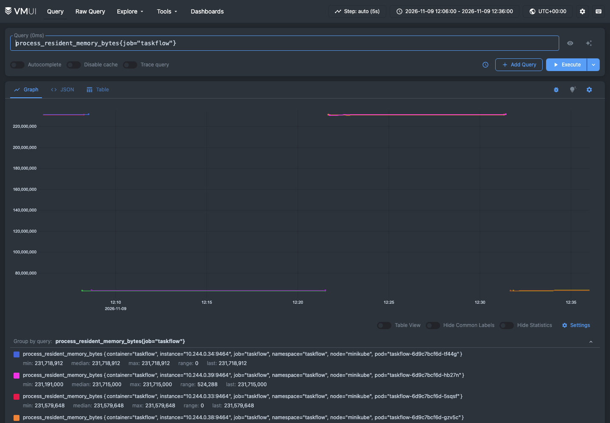
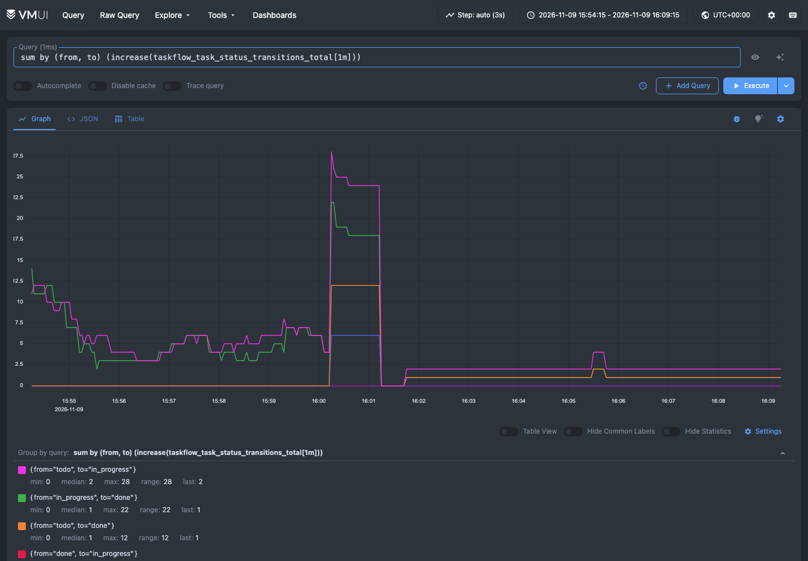

# Отчёт: метрики TaskFlow в VictoriaMetrics (minikube)

## 1. Стек

| Компонент | Версия | Роль |
|---|---|---|
| **TaskFlow** | 2.0.0 (образ `taskflow:2.0`) | приложение из ДЗ №1: Python 3.13 + FastAPI, REST API проектов и задач |
| PostgreSQL | 17 (`postgres:17-alpine`) | база приложения, StatefulSet `db` с PVC |
| minikube / Kubernetes | v1.39 / v1.37 | кластер; драйвер и рантайм контейнеров `docker` |
| **VictoriaMetrics single** | v1.154.0, чарт `vm/victoria-metrics-single` 0.49.0 | TSDB: хранение метрик, API запросов (`/api/v1/query`), vmui |
| **vmagent** | v1.154.0, чарт `vm/victoria-metrics-agent` 0.50.0 | сбор метрик: service discovery в Kubernetes, скрейп, remote write в VictoriaMetrics |
| **prometheus_client** | 0.22.1 | официальная клиентская библиотека метрик для Python: рантайм (готовые коллекторы), HTTP, бизнес-метрики |
| **postgres-exporter** | v0.20.1 (`quay.io/prometheuscommunity/postgres-exporter`) | готовый экспортер метрик PostgreSQL, sidecar в поде БД |
| Helm | v4.3 | установка чартов VictoriaMetrics |

Состав архива:

| Путь | Назначение |
|---|---|
| `app/` | исходники приложения с `Dockerfile` (в репозитории — `../app`); метрики — `taskflow/metrics.py`, `taskflow/metrics_server.py`, HTTP-метрика в `taskflow/middleware.py`, `migrations/002_monitoring_role.sql`, тесты |
| `k8s/app/*.yaml` | манифесты приложения и БД: аннотации `prometheus.io/*`, порт метрик, sidecar postgres-exporter |
| `k8s/monitoring/*.yaml` | namespace `monitoring` и values для двух Helm-чартов |
| `k8s/monitoring/rendered/*.yaml` | итоговые манифесты чартов (`helm template` с теми же values и версиями) — всё, что Helm применил в кластер |
| `scripts/*.sh` | сборка образа, деплой, туннели, трафик, проверка метрик, запись скринкаста, архив |
| `screenshots/*.png` | таргеты vmagent и графики vmui (разделы 3–6) |
| `screencast/screencast.mp4` | скринкаст: поды и сервисы Victoria Metrics, проверка сбора метрик |
| `README.md` | инструкция по запуску |

## 2. VictoriaMetrics в кластере (Helm)

Установка по инструкции VictoriaMetrics «Kubernetes monitoring via VictoriaMetrics Single», первые два
шага — Helm-репозиторий и чарт `victoria-metrics-single` (`scripts/deploy.sh`):

```bash
helm repo add vm https://victoriametrics.github.io/helm-charts/
helm repo update vm
kubectl apply -f k8s/monitoring/00-namespace.yaml
helm upgrade --install vm-single vm/victoria-metrics-single --version 0.49.0 \
  -n monitoring -f k8s/monitoring/vmsingle-values.yaml --wait
helm upgrade --install vm-agent vm/victoria-metrics-agent --version 0.50.0 \
  -n monitoring -f k8s/monitoring/vmagent-values.yaml --wait
```

Отличие от инструкции одно, и оно осознанное: в инструкции скрейп выполняет сама VictoriaMetrics
(встроенный promscrape, `server.scrape.enabled: true`), а здесь сбор вынесен в отдельный **vmagent** —
второй чарт того же репозитория. Так разделены обязанности: VictoriaMetrics только хранит и отдаёт
данные, vmagent находит цели, скрейпит и при недоступности хранилища копит данные в очереди на диске.
Это та же схема, что в задании (команды проверки обращаются к `vm-single-victoria-metrics-agent:8429`),
и та, что используют в проде. Встроенный скрейп в VictoriaMetrics выключен, чтобы цели не собирались
дважды.

Что задано в values:

| Файл | Настройки |
|---|---|
| `vmsingle-values.yaml` | `retentionPeriod: 14d`; PVC 4 Gi (StorageClass по умолчанию `standard`); `scrape.enabled: false`; requests/limits; аннотации `prometheus.io/*` — VictoriaMetrics собирает собственные метрики тем же service discovery |
| `vmagent-values.yaml` | `remoteWrite` → `http://vm-single-victoria-metrics-single-server.monitoring.svc:8428/api/v1/write`; Service включён (в чарте по умолчанию выключен); `scrape_configs` — одна задача `kubernetes-pods` (раздел 3); `fullnameOverride`, чтобы имя Service совпало с командами из задания |
| оба | профиль Pod Security **restricted**: `runAsNonRoot`, `seccompProfile: RuntimeDefault`, `readOnlyRootFilesystem`, `capabilities: drop ALL`. Namespace `monitoring` создаётся манифестом с меткой `pod-security.kubernetes.io/enforce: restricted`, а не флагом `--create-namespace`, — API-сервер не пустит под, нарушающий профиль |

Версии чартов закреплены (`--version`) — повторный деплой ставит те же образы. `helm upgrade --install`
идемпотентен: первый запуск ставит релиз, следующий обновляет.

```
$ helm list -n monitoring
NAME       NAMESPACE   REVISION  STATUS    CHART                           APP VERSION
vm-agent   monitoring  2         deployed  victoria-metrics-agent-0.50.0   v1.154.0
vm-single  monitoring  2         deployed  victoria-metrics-single-0.49.0  v1.154.0

$ kubectl get pods -n monitoring
NAME                                                READY   STATUS    RESTARTS   AGE
vm-single-victoria-metrics-agent-65dd48f4f7-7k8qg   1/1     Running   0          7m55s
vm-single-victoria-metrics-single-server-0          1/1     Running   0          8m21s

$ kubectl get svc -n monitoring
NAME                                       TYPE        CLUSTER-IP       PORT(S)
vm-single-victoria-metrics-agent           ClusterIP   10.108.188.162   8429/TCP
vm-single-victoria-metrics-single-server   ClusterIP   None             8428/TCP

$ kubectl get pvc -n monitoring
NAME                                                       STATUS   CAPACITY   STORAGECLASS
server-volume-vm-single-victoria-metrics-single-server-0   Bound    4Gi        standard
```

## 3. Сбор через service discovery (аннотации `prometheus.io/*`)

Pull-модель: каждый под с метриками сам объявляет в шаблоне, что его нужно скрейпить и где:

```yaml
# k8s/app/20-app.yaml (Deployment taskflow), фрагмент
spec:
  template:
    metadata:
      annotations:
        prometheus.io/scrape: "true"
        prometheus.io/port: "9464"
        prometheus.io/path: /metrics
    spec:
      containers:
        - name: taskflow
          ports:
            - name: http
              containerPort: 3000
            - name: metrics
              containerPort: 9464
```

Те же три аннотации стоят у пода PostgreSQL (порт экспортера `9187`) и у подов самих VictoriaMetrics
(`8428`) и vmagent (`8429`, через `podAnnotations` в values).

vmagent следит за подами через API Kubernetes (`kubernetes_sd_configs: role: pod`, права даёт
ClusterRole из чарта) и превращает аннотации в цели relabeling'ом (`k8s/monitoring/vmagent-values.yaml`):

| Шаг | Правило | Зачем |
|---|---|---|
| 1 | `keep` по `prometheus.io/scrape = "true"` | скрейпим только поды, которые сами это объявили |
| 2 | `drop` фаз `Succeeded\|Failed` | завершившиеся поды метрик уже не отдают |
| 3 | `drop` init-контейнеров и `keep_if_equal` (порт из аннотации = порт контейнера) | `role: pod` даёт по цели на каждый порт каждого контейнера; у пода `taskflow` их два (3000 и 9464), у `db-0` — два контейнера (5432 и 9187). Остаётся ровно одна цель — на порту из аннотации |
| 4 | `__metrics_path__` из `prometheus.io/path` | путь, если он не `/metrics` |
| 5 | метки `job` (из `app.kubernetes.io/name`), `namespace`, `pod`, `container`, `node` | по ним ряды ищут и группируют: `up{job="taskflow"}`, `pg_up{pod="db-0"}` |

Подключить к мониторингу новое приложение — значит добавить аннотации в его Deployment;
конфигурацию vmagent менять не нужно. Новая реплика попадает в мониторинг сама: после масштабирования
или перезапуска пода vmagent получает событие от API и начинает скрейпить новый IP.


Все найденные цели — `UP`: две реплики `taskflow`, `postgres` (экспортер в `db-0`),
`victoria-metrics-single` и `victoria-metrics-agent`. Интервал скрейпа — 15 с. Ещё две цели —
`victoria-metrics-alert` (vmalert) и `alertmanager` — из следующих заданий (ДЗ №5–6), развёрнутых
в том же кластере: они тоже объявили аннотации `prometheus.io/*`, и vmagent подхватил их сам, без
правки своей конфигурации — ровно то, ради чего нужен service discovery.

```
$ curl -s http://localhost:8429/metrics | grep -E '^vm_promscrape_(targets\{type="kubernetes_sd_configs"|scrapes_total|scrapes_failed_total)'
vm_promscrape_scrapes_failed_total 15
vm_promscrape_scrapes_total{status_code="200"} 2320
vm_promscrape_targets{type="kubernetes_sd_configs", status="down"} 0
vm_promscrape_targets{type="kubernetes_sd_configs", status="up"} 7

$ curl -s 'http://localhost:8428/api/v1/query?query=up' | jq -r '.data.result[] | "\(.value[1])  \(.metric.job)  \(.metric.pod)"'
1  alertmanager  alertmanager-6584785968-kgxsp
1  victoria-metrics-agent  vm-single-victoria-metrics-agent-65dd48f4f7-vcmbr
1  victoria-metrics-alert  vmalert-75d7d8c895-7sw85
1  victoria-metrics-single  vm-single-victoria-metrics-single-server-0
1  postgres  db-0
1  taskflow  taskflow-84645cdbc9-jdrbr
1  taskflow  taskflow-84645cdbc9-6g6lr
```

15 неудачных скрейпов из ~2300 — моменты, когда под уже завершался: при перекатах Deployment и
пересоздании `db-0` в демонстрациях сбоев vmagent ещё успевает обратиться к уходящему поду.
Ошибки видны в UI vmagent (колонка Errors); у работающих подов новых нет.

## 4. Метрики рантайма и HTTP (готовая библиотека prometheus_client)

**Где отдаются.** `GET /metrics` на отдельном порту `METRICS_PORT=9464` — это отдельный HTTP-сервер
внутри процесса ([`taskflow/metrics_server.py`](../app/taskflow/metrics_server.py), стандартный
`http.server` в своём потоке), а не маршрут FastAPI-приложения:

* порт не публикуется в Service `taskflow` (там только `http`), поэтому метрики не видны снаружи
  кластера, а vmagent ходит прямо на IP пода. Авторизация не нужна, но и наружу URL не торчит —
  как и требует задание;
* скрейпы не проходят через rate limit и не пишут access-лог (иначе каждые 15 с на каждой реплике
  в Victoria Logs из ДЗ №3 появлялась бы строка о скрейпе);
* сервер работает в отдельном потоке: даже если цикл событий приложения занят, скрейп отвечает,
  а при остановке пода метрики отдаются, пока основной сервер дорабатывает запросы, — последние
  значения счётчиков успевают уехать в хранилище.

Формат — **OpenMetrics 1.0** (`Content-Type: application/openmetrics-text; version=1.0.0`): `# TYPE`
у счётчика без суффикса `_total`, в конце `# EOF`. Служебные ряды `*_created`, которые
prometheus_client добавляет к счётчикам в OpenMetrics, отключены (`disable_created_metrics()`) —
в хранилище они лишние. Ответы: `200` на GET/HEAD `/metrics`, `404` на другие пути, `405` на другие
методы, `500` при ошибке сбора (скрейп считается неудачным, а не сохраняет неполные данные).

```
$ kubectl exec -n taskflow deploy/taskflow -c taskflow -- python -c "import urllib.request as u; print('Content-Type:', u.urlopen('http://127.0.0.1:9464/metrics').headers['Content-Type'])"
Content-Type: application/openmetrics-text; version=1.0.0; charset=utf-8
$ kubectl exec -n taskflow deploy/taskflow -c taskflow -- python -c "import urllib.request as u; print(u.urlopen('http://127.0.0.1:9464/metrics').read().decode(), end='')" | grep -A4 '^# HELP taskflow_task_status'
# HELP taskflow_task_status_transitions Task status changes, by previous and new status
# TYPE taskflow_task_status_transitions counter
taskflow_task_status_transitions_total{from="todo",to="in_progress"} 24.0
taskflow_task_status_transitions_total{from="todo",to="done"} 12.0
taskflow_task_status_transitions_total{from="in_progress",to="todo"} 0.0
```

**Рантайм Python** — готовые коллекторы prometheus_client, без собственного кода
([`taskflow/metrics.py`](../app/taskflow/metrics.py) только регистрирует их в реестре приложения):

| Метрика | Коллектор | Что показывает |
|---|---|---|
| `process_cpu_seconds_total` | ProcessCollector | процессорное время; `rate()` — загрузка CPU |
| `process_resident_memory_bytes`, `process_virtual_memory_bytes` | ProcessCollector | память процесса (RSS) — утечки видны как рост без спада; рядом с лимитом контейнера — риск OOMKilled |
| `process_open_fds`, `process_max_fds` | ProcessCollector | открытые дескрипторы (сокеты, файлы) и их предел |
| `process_start_time_seconds` | ProcessCollector | время старта процесса — по его изменению видны перезапуски контейнера |
| `python_gc_collections_total{generation}`, `python_gc_objects_collected_total{generation}`, `python_gc_objects_uncollectable_total{generation}` | GCCollector | работа сборщика мусора по поколениям 0/1/2; рост `uncollectable` — объекты, которые GC не может освободить |
| `python_info{version, implementation}` | PlatformCollector | версия интерпретатора (CPython 3.13) |

У одной реплики от ~80 рядов (рантайм и бизнес-метрики) до ~230 (плюс HTTP-гистограммы — по 12 рядов на каждую встреченную пару маршрут + статус).

**HTTP (метрики фреймворка)** — гистограмма `http_request_duration_seconds{method, route, status_code}`
(middleware [`taskflow/middleware.py`](../app/taskflow/middleware.py)). `_count` — число запросов (RPS,
доля ошибок), `_bucket` — перцентили задержки. Метка `route` — **шаблон маршрута FastAPI**
(`/api/tasks/{task_id}` записывается как `/api/tasks/:id`), а не фактический путь: иначе каждый id
задачи порождал бы новый временной ряд. Запросы, не дошедшие до обработчика маршрута, —
`route="unmatched"` под `/api` (404, rate limit) и `route="static"` для файлов интерфейса. Статус
берётся тем же кодом, что и в access-логе: оборванный клиентом запрос — `499`.


`sum by (route) (rate(http_request_duration_seconds_count{job="taskflow"}[1m]))` — запросы в секунду
по шаблонам маршрутов (время на графиках vmui — UTC): ровный фон проб kubelet `/api/ready` и
`/api/health`; до 15:59 — ещё и запросы пробера из ДЗ №5 (развёрнут в том же кластере, на время
замера бизнес-метрик остановлен), в 16:00 — всплеск 12 раундов генератора, провал в 16:01 —
перезапуск подов перед замером, после 16:02 — по раунду генератора в минуту. Каждый маршрут —
свой ряд (`/api/tasks/:id`, а не ряд на каждый id).



`process_resident_memory_bytes{job="taskflow"}` по подам (время на графике — UTC): в обычной работе
процесс Python занимает около 64 МБ. С 12:21 до 12:31 видна ревизия с внесённой «утечкой»
(`FAULT_MEMORY_MB=160`, ДЗ №6): у новых подов RSS сразу ~231 МБ — 86 % лимита контейнера 256 MiB;
по этой метрике в ДЗ №6 и сработал алерт `TaskflowHighMemoryUsage`. После снятия сбоя поды новой
ревизии снова занимают ~64 МБ. Ряды обрываются при каждом перекате: у нового пода — новый ряд.

## 5. Бизнес-метрики

Шесть метрик предметной области «трекер задач» ([`taskflow/metrics.py`](../app/taskflow/metrics.py), функции `record_*`; вызываются из `taskflow/routes/`):

| Метрика | Тип | Метки | Когда растёт | Что отвечает |
|---|---|---|---|---|
| `taskflow_projects_created_total` | counter | — | проект создан (`POST /api/projects` → 201) | сколько проектов заводят: активность команд |
| `taskflow_projects_deleted_total` | counter | — | проект удалён (вместе с задачами, `DELETE` → 204) | отток / закрытие проектов |
| `taskflow_tasks_created_total` | counter | `status` — начальный статус | задача создана | входящий поток работы; `status="in_progress"` — задачи, заведённые «задним числом» |
| `taskflow_task_status_transitions_total` | counter | `from`, `to` | статус задачи изменился (`PUT` с другим статусом) | движение по воронке `todo → in_progress → done`; `from="done"` — переоткрытия (возвраты в работу) |
| `taskflow_task_lead_time_seconds` | histogram | — | задача переведена в `done` | время от создания задачи до готовности; `_count` — сколько задач закрыто, `_bucket` — перцентили |
| `taskflow_tasks_deleted_total` | counter | `status` на момент удаления | задача удалена через API | `status="todo"` — брошенная, так и не начатая работа |

Как сделано, чтобы цифры были честными:

* **Считаются только успешные изменения в БД.** Счётчик увеличивается после того, как `INSERT`,
  `UPDATE` или `DELETE` вернул строку; ответы 400/404/422 метрики не трогают (это проверяет
  интеграционный тест).
* **Переход статуса — атомарно.** Старый статус читается в том же `UPDATE`:
  `UPDATE tasks … FROM (SELECT id, status FROM tasks WHERE id = $1 FOR UPDATE) AS prev … RETURNING …, prev.prev_status`.
  `FOR UPDATE` блокирует строку, поэтому параллельный запрос не вклинится между чтением старого статуса
  и записью нового, и пара `(from, to)` всегда соответствует действительности. `PUT` без смены статуса
  (переименование) переходом не считается.
* **Время выполнения — по часам БД**: `updated_at − created_at`, обе отметки ставит PostgreSQL, а не
  часы реплики. Переоткрытая и снова закрытая задача даёт второе наблюдение (от `created_at`) —
  переоткрытие честно увеличивает время до готовности. Корзины — от минуты до месяца.
* **Ряды заведены заранее со значением 0** — все `status` и все шесть пар `(from, to)`. Ряд виден на
  графиках сразу после старта, а первый инкремент — это переход `0 → 1`, который `increase()`/`rate()`
  засчитывают. Кардинальность ограничена: статусов три, переходов шесть.
* **Каждая реплика считает свои события** — общую картину даёт `sum()` по репликам.

Значения после `scripts/generate-traffic.sh` (`scripts/check-metrics.sh business`):

```
=== Бизнес-метрики TaskFlow (сумма по репликам)
▸ sum(taskflow_projects_created_total)
  {}  12
▸ sum(taskflow_projects_deleted_total)
  {}  4
▸ sum by (status) (taskflow_tasks_created_total)
  {status=done}  0
  {status=in_progress}  12
  {status=todo}  36
▸ sum by (from, to) (taskflow_task_status_transitions_total) > 0
  {from=done, to=todo}  6
  {from=in_progress, to=done}  18
  {from=todo, to=done}  12
  {from=todo, to=in_progress}  24
▸ sum(taskflow_task_lead_time_seconds_count)
  {}  30
▸ sum(taskflow_task_lead_time_seconds_sum) / sum(taskflow_task_lead_time_seconds_count)
  {}  0.09666
▸ sum by (status) (taskflow_tasks_deleted_total)
  {status=done}  12
  {status=in_progress}  0
  {status=todo}  0
```

Цифры сходятся со сценарием генератора: замер сделан после перезапуска подов (счётчики с нуля) и
ровно 12 раундов `generate-traffic.sh --rounds 12`; пробер из ДЗ №5, который тоже создаёт задачи, на
время замера остановлен. В каждом раунде создаётся проект и четыре задачи (три `todo`, одна
`in_progress`) → 12 проектов, 36 + 12 задач; переходов `todo → in_progress` по два на раунд (24),
`todo → done` по одному (12), `in_progress → done` — по одному на раунд плюс ещё один в чётных
раундах (12 + 6 = 18), и эти 6 задач затем переоткрываются (`done → todo`); закрытий 18 + 12 = 30;
каждый раунд удаляет одну задачу в `done` (12), каждый третий — проект (4). Среднее время выполнения —
0,1 с, потому что генератор закрывает задачи сразу; на реальном трафике это минуты и дни (корзины
гистограммы от минуты до месяца).



`sum by (from, to) (increase(taskflow_task_status_transitions_total[1m]))` — переходы статусов за
минуту (UTC): до 15:59 — фон пробера ДЗ №5 (каждые 5 с он проводит задачу `todo → in_progress → done`),
в 16:00 — 12 раундов замера (24 перехода `todo → in_progress`, 18 `in_progress → done`, 12
`todo → done`, 6 переоткрытий `done → todo`), после 16:02 — по раунду в минуту. `increase()` вместо
сырого счётчика, потому что счётчик в памяти реплики обнуляется при её перезапуске (в 16:01 поды
перезапускались), а `increase()` такой сброс учитывает.

Как этими метриками пользоваться дальше (пригодятся для Grafana и алертов в следующих заданиях):

```promql
sum(rate(taskflow_tasks_created_total[1h])) * 3600                     # задач в час
sum(rate(taskflow_task_status_transitions_total{to="done"}[1d]))
  / sum(rate(taskflow_tasks_created_total[1d]))                         # закрывается ли столько, сколько приходит
histogram_quantile(0.9, sum by (le) (rate(taskflow_task_lead_time_seconds_bucket[7d])))   # p90 времени выполнения
sum(rate(taskflow_task_status_transitions_total{from="done"}[1d]))     # переоткрытия: качество «готово»
```

## 6. Метрики PostgreSQL (готовый экспортер)

**postgres-exporter** добавлен sidecar-контейнером в под `db-0` (`k8s/app/10-postgres.yaml`).
Контейнеры пода делят сетевое пространство, поэтому экспортер подключается к PostgreSQL по
`127.0.0.1:5432` и отдаёт метрики на `:9187/metrics`; vmagent находит под по аннотациям
`prometheus.io/port: "9187"`. Service `db` по-прежнему публикует только порт PostgreSQL.

Безопасность подключения:

* экспортер ходит не под суперпользователем `taskflow`, а под отдельной ролью **`postgres_exporter`**
  со встроенной ролью **`pg_monitor`**: чтение статистики (`pg_stat_*`, размеры БД, настройки) без
  доступа к данным приложения. Роль создаёт идемпотентная миграция приложения
  `migrations/002_monitoring_role.sql`; если у пользователя миграций нет права создавать роли
  (управляемая БД), миграция не падает, а пишет предупреждение — мониторинг не роняет приложение;
* пароля у роли нет и Secret экспортеру не монтируется: в образе `postgres` подключения с `127.0.0.1`
  разрешены методом `trust`, а снаружи пода (`host all all all scram-sha-256`) роль без пароля войти
  не может;
* у контейнера те же ограничения профиля restricted, только liveness-проба — readiness экспортера
  сделала бы готовность пода БД (и DNS-имя `db`) зависимой от мониторинга.

Основные метрики (всего ~350 имён `pg_*`):

| Метрика | Что показывает |
|---|---|
| `pg_up` | экспортер подключился к БД (1) — главный признак доступности СУБД |
| `pg_stat_database_numbackends{datname}` | открытые соединения по базам (пулы реплик приложения) |
| `pg_stat_database_xact_commit` / `_xact_rollback` | транзакции — `rate()` даёт TPS и долю откатов |
| `pg_stat_database_tup_inserted` / `_updated` / `_deleted` / `_fetched` | строки по операциям |
| `pg_stat_database_deadlocks`, `pg_locks_count{mode}` | взаимоблокировки и блокировки |
| `pg_database_size_bytes{datname}` | размер базы — рост для планирования диска |
| `pg_stat_user_tables_n_live_tup` / `_n_dead_tup{relname}` | живые и «мёртвые» строки таблиц `projects`, `tasks` — нужен ли VACUUM |
| `pg_stat_activity_count{state}`, `pg_stat_bgwriter_*`, `pg_settings_*` | активность сессий, фоновая запись, параметры сервера |

```
=== PostgreSQL (postgres-exporter)
▸ pg_up
  {job=postgres, namespace=taskflow, pod=db-0}  1
▸ pg_stat_database_numbackends{datname="taskflow"}
  {datid=16384, datname=taskflow, job=postgres, namespace=taskflow, pod=db-0}  5
▸ rate(pg_stat_database_xact_commit{datname="taskflow"}[5m])
  {datid=16384, datname=taskflow, job=postgres, namespace=taskflow, pod=db-0}  4.367
▸ pg_database_size_bytes{datname="taskflow"}
  {datname=taskflow, job=postgres, namespace=taskflow, pod=db-0}  8001203
▸ pg_stat_user_tables_n_live_tup{datname="taskflow"}
  {datname=taskflow, job=postgres, namespace=taskflow, pod=db-0, relname=projects, schemaname=public}  64
  {datname=taskflow, job=postgres, namespace=taskflow, pod=db-0, relname=schema_migrations, schemaname=public}  1
  {datname=taskflow, job=postgres, namespace=taskflow, pod=db-0, relname=tasks, schemaname=public}  54
```


`rate(pg_stat_database_xact_commit{datname="taskflow"}[1m])` — транзакций в секунду в базе приложения
(UTC): фон ~2,7 TPS — пробы готовности `/api/ready` (`SELECT 1` раз в 5 с на каждой реплике) и сам
экспортер; до 15:59 сверху — пробер ДЗ №5, в 16:00 — всплеск до ~7 TPS от 12 раундов генератора
(каждый запрос API — своя транзакция, autocommit).

## 7. Проверка и скринкаст

`screencast/screencast.mp4` — запись терминала (asciinema, реальные команды и их вывод; сценарий —
`scripts/demo.sh`, запись — `scripts/record-screencast.sh`):

1. `helm list`, `kubectl get pods -n monitoring`, `kubectl get svc -n monitoring`, поды приложения
   (`db-0` — `2/2`: PostgreSQL и экспортер);
2. `kubectl port-forward` к `vm-single-victoria-metrics-single-server:8428` и
   `vm-single-victoria-metrics-agent:8429`;
3. `/metrics` пода приложения изнутри кластера (OpenMetrics; запрос — однострочником на Python: в
   образе `python:3.13-slim` нет ни `curl`, ни `wget`);
4. таргеты vmagent и `curl http://localhost:8429/metrics` — статус скрейпинга;
5. `curl http://localhost:8428/api/v1/label/__name__/values` — сколько имён метрик и какие от
   приложения и PostgreSQL; `curl 'http://localhost:8428/api/v1/query?query=up'`;
6. трафик к приложению и запросы к бизнес-метрикам, рантайму, HTTP и PostgreSQL.

В кластере на момент записи работали и стенды ДЗ №5–6 (vmalert, Alertmanager, Grafana, Mailpit в
namespace `monitoring`), поэтому в списке подов и таргетов их больше, чем ставит это задание.

Воспроизвести проверку:

```bash
scripts/build-image.sh && scripts/deploy.sh
scripts/port-forward.sh           # отдельный терминал
scripts/generate-traffic.sh
scripts/check-metrics.sh
```

**Тесты приложения** (`python -m pytest` в `app/`): 48 тестов, среди них — реестр отдаёт
OpenMetrics с метриками рантайма и без рядов `*_created`; ряды бизнес-метрик заведены с нулём;
переходы и время выполнения считаются только при смене статуса (переименование задачи — не переход);
сервер `/metrics` отвечает 200/404/405; `route` — шаблон маршрута (`/api/projects/:id`, `unmatched`
для неизвестных путей под `/api`); интеграционный тест через API проверяет, что бизнес-метрики растут
только на успешных изменениях, а ответ 400 их не трогает.

## 8. Ограничения

* **Сетевая изоляция портов метрик** — только на уровне Service: `9464` и `9187` не опубликованы, но
  любой под кластера может обратиться к ним по IP пода. Полную изоляцию дала бы NetworkPolicy
  «ingress на порт метрик — только из namespace `monitoring`», но CNI minikube по умолчанию (bridge)
  NetworkPolicy не применяет, поэтому в манифесты она не добавлена.
* **Вход экспортера без пароля** держится на `trust` для `127.0.0.1` из `pg_hba.conf` образа `postgres`:
  войти так может любой контейнер пода БД — а их там два, PostgreSQL и экспортер. `pg_monitor` включает
  `pg_read_all_stats`, то есть видит тексты запросов других сессий в `pg_stat_activity`; коллекторы
  экспортера по умолчанию тексты запросов не экспортируют.
* **Очередь vmagent** лежит в `emptyDir`: переживает перезапуск контейнера, но не пересоздание пода.
  Для прода — `persistentVolume` в values vmagent.
* **Бизнес-метрики считаются в памяти реплики** и обнуляются при её перезапуске; `rate()`/`increase()`
  это корректно учитывают (сброс счётчика), а абсолютные «всего за всё время» значения берутся из БД,
  а не из метрик.
* Grafana не ставилась — по заданию она будет на следующих семинарах; запросы для дашбордов — в
  разделе 5.
