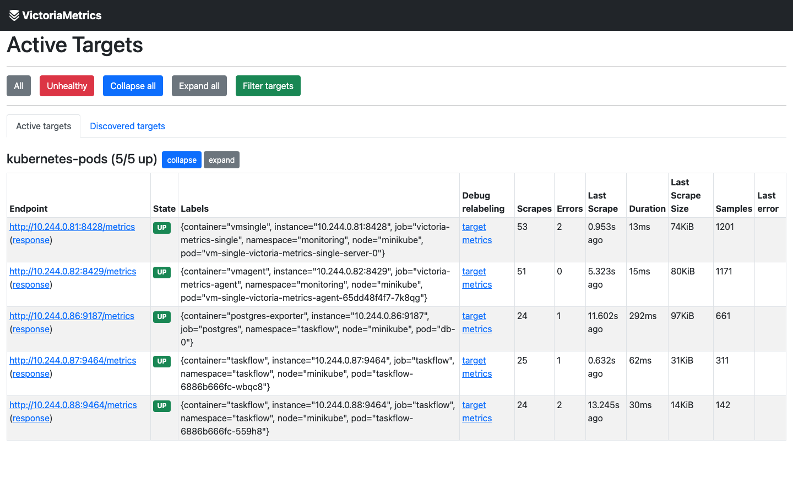
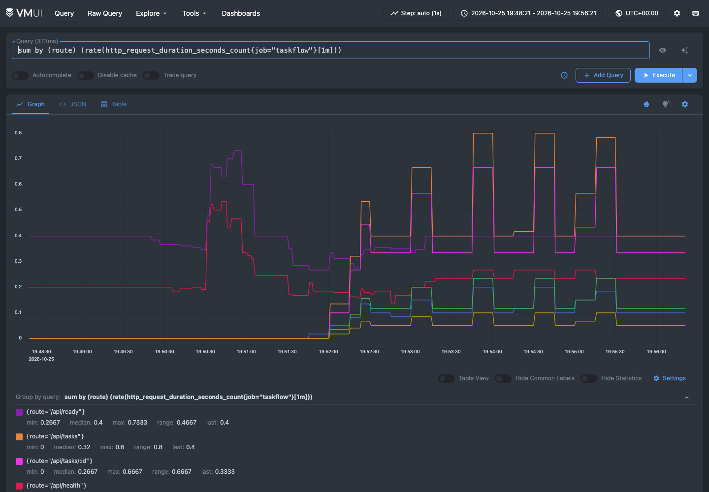
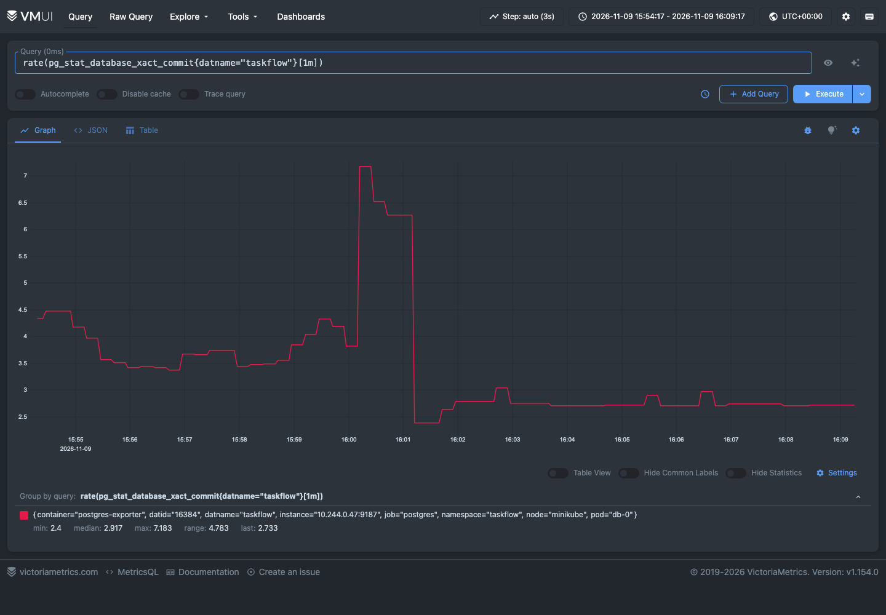

# Отчёт по ДЗ 4: метрики

В этом задании я подключила к своему приложению TaskFlow сбор метрик. Метрики хранятся в
VictoriaMetrics, а собирает их vmagent. Всё развёрнуто в minikube рядом с приложением из прошлых ДЗ.

Манифесты лежат в `k8s/`, скрипты в `scripts/`, скриншоты в `screenshots/`, видео —
[screencast/screencast.mp4](screencast/screencast.mp4). Как всё запустить — в [README.md](README.md).

## VictoriaMetrics в кластере

VictoriaMetrics я ставила через Helm по официальной инструкции:

```bash
helm repo add vm https://victoriametrics.github.io/helm-charts/
helm upgrade --install vm-single vm/victoria-metrics-single --version 0.49.0 \
  -n monitoring -f k8s/monitoring/vmsingle-values.yaml
helm upgrade --install vm-agent vm/victoria-metrics-agent --version 0.50.0 \
  -n monitoring -f k8s/monitoring/vmagent-values.yaml
```

От инструкции я отошла в одном месте: метрики собирает не сама VictoriaMetrics, а отдельный
vmagent (второй чарт из того же репозитория). Так обязанности разделены: VictoriaMetrics только
хранит данные, а vmagent ищет, что собирать, и опрашивает поды. Если хранилище недоступно, vmagent
копит данные у себя и отправит их позже. Встроенный сбор в самой VictoriaMetrics я выключила,
чтобы метрики не собирались дважды.

Данные хранятся 14 дней на диске 4 ГБ.

```
$ kubectl get pods -n monitoring
NAME                                                READY   STATUS
vm-single-victoria-metrics-agent-65dd48f4f7-7k8qg   1/1     Running
vm-single-victoria-metrics-single-server-0          1/1     Running

$ kubectl get svc -n monitoring
NAME                                       TYPE        PORT(S)
vm-single-victoria-metrics-agent           ClusterIP   8429/TCP
vm-single-victoria-metrics-single-server   ClusterIP   8428/TCP
```

## Как vmagent находит, что собирать

Каждый под сам сообщает аннотациями, что с него нужно собирать метрики и где они лежат:

```yaml
annotations:
  prometheus.io/scrape: "true"
  prometheus.io/port: "9464"
  prometheus.io/path: /metrics
```

vmagent следит за подами через API Kubernetes и опрашивает только те, у которых стоит
`scrape: "true"`, на порту из аннотации. Поэтому, чтобы подключить к мониторингу новое приложение,
достаточно добавить ему аннотации, а настройки vmagent менять не нужно. Новые реплики тоже
подхватываются сами. Так vmagent без моего участия начал собирать метрики vmalert и Alertmanager
из следующих ДЗ.



Все цели в состоянии UP: две реплики приложения, PostgreSQL, сама VictoriaMetrics и vmagent.
Опрос раз в 15 секунд.

```
$ curl -s 'http://localhost:8428/api/v1/query?query=up'
1  taskflow  taskflow-84645cdbc9-jdrbr
1  taskflow  taskflow-84645cdbc9-6g6lr
1  postgres  db-0
1  victoria-metrics-single  vm-single-victoria-metrics-single-server-0
1  victoria-metrics-agent   vm-single-victoria-metrics-agent-65dd48f4f7-vcmbr
```

## Метрики приложения

Метрики отдаёт официальная библиотека `prometheus_client`. Я вынесла `/metrics` на отдельный порт
9464. Он не опубликован в Service, поэтому снаружи кластера метрики не видны, а vmagent ходит
прямо в под. Заодно запросы мониторинга не попадают в логи приложения и в лимит запросов.

**Рантайм Python** — это готовые коллекторы библиотеки, своего кода тут нет:

| Метрика | Что показывает |
|---|---|
| `process_cpu_seconds_total` | процессорное время |
| `process_resident_memory_bytes` | сколько памяти занимает процесс |
| `process_open_fds` | сколько открыто файлов и сокетов |
| `process_start_time_seconds` | когда стартовал процесс — по нему видны перезапуски |
| `python_gc_*` | работа сборщика мусора |
| `python_info` | версия Python |

**HTTP-запросы** — гистограмма `http_request_duration_seconds` с метками `method`, `route` и
`status_code`. По ней считаются число запросов, доля ошибок и время ответа. В `route` я пишу шаблон
маршрута (`/api/tasks/:id`), а не настоящий путь, иначе каждый id задачи давал бы новый временной
ряд.




На графике памяти видно, что обычно процесс занимает около 64 МБ. Участок около 231 МБ — это
«утечка», которую я специально включала для алертов в ДЗ 6.

## Бизнес-метрики

Я добавила шесть метрик про то, что происходит с проектами и задачами:

| Метрика | Что показывает |
|---|---|
| `taskflow_projects_created_total` | сколько создано проектов |
| `taskflow_projects_deleted_total` | сколько проектов удалено |
| `taskflow_tasks_created_total{status}` | сколько создано задач, с каким статусом |
| `taskflow_task_status_transitions_total{from, to}` | как задачи переходят между статусами `todo`, `in_progress`, `done` |
| `taskflow_task_lead_time_seconds` | сколько времени проходит от создания задачи до готовности |
| `taskflow_tasks_deleted_total{status}` | сколько задач удалено и в каком статусе (`todo` — работа, которую бросили) |

Счётчик растёт только после того, как изменение успешно записалось в базу. Запросы с ошибками
(400, 404) метрики не трогают. Все ряды заводятся сразу с нулём, чтобы их было видно на графиках с
момента старта.

Чтобы проверить, что метрики считают правильно, я прогнала генератор трафика 12 раундов. Цифры
сошлись со сценарием: 12 проектов, 48 задач, 24 перехода `todo → in_progress`, 30 закрытых задач.

```
▸ sum(taskflow_projects_created_total)                     12
▸ sum by (status) (taskflow_tasks_created_total)           todo 36, in_progress 12
▸ sum by (from, to) (taskflow_task_status_transitions_total)
    todo → in_progress 24,  in_progress → done 18,  todo → done 12,  done → todo 6
▸ sum(taskflow_task_lead_time_seconds_count)               30
```


## Метрики PostgreSQL

Для базы я взяла готовый `postgres-exporter` и добавила его вторым контейнером в под PostgreSQL.
Он подключается к базе по `127.0.0.1` под отдельной ролью с правами `pg_monitor`: она может читать
статистику, но не данные приложения.

Основные метрики: `pg_up` (база доступна), число соединений, транзакции в секунду, размер базы,
число строк в таблицах.

```
▸ pg_up                                                    1
▸ pg_stat_database_numbackends{datname="taskflow"}         5
▸ rate(pg_stat_database_xact_commit{datname="taskflow"}[5m])   4.4 транзакции/с
▸ pg_database_size_bytes{datname="taskflow"}              8 МБ
```



## Видео

В [screencast.mp4](screencast/screencast.mp4) показано:

1. Helm-релизы, поды и сервисы VictoriaMetrics;
2. `port-forward` к VictoriaMetrics (8428) и vmagent (8429);
3. `/metrics` пода приложения;
4. цели vmagent и статус сбора;
5. список метрик и запрос `up`;
6. трафик к приложению и запросы к бизнес-метрикам, рантайму, HTTP и PostgreSQL.

## Как проверить

```bash
scripts/build-image.sh && scripts/deploy.sh
scripts/port-forward.sh           # в отдельном терминале
scripts/generate-traffic.sh
scripts/check-metrics.sh
```
