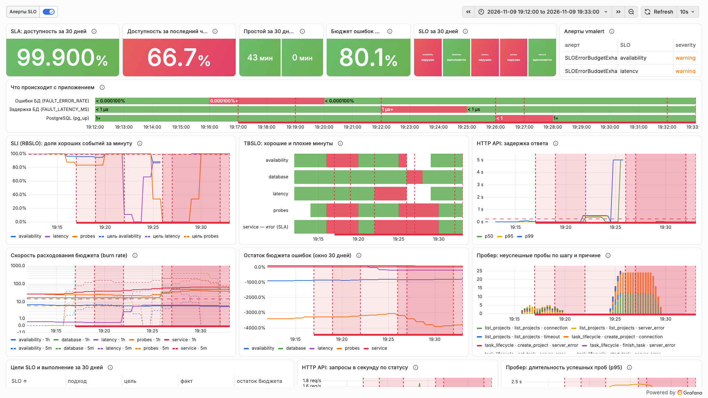

# Отчёт по ДЗ 5: SLI, SLO и SLA

В этом задании я придумала для TaskFlow показатели надёжности (SLI), цели по ним (SLO) и
обещание клиентам (SLA). Считает всё vmalert по метрикам из ДЗ 4, а показывает дашборд в Grafana.

Правила лежат в `k8s/monitoring/rules/`, дашборд — в `k8s/monitoring/dashboards/`, видео —
[screencast/screencast.mp4](screencast/screencast.mp4). Как запустить — в [README.md](README.md).

## Какие метрики я взяла

| Метрика | Откуда | Зачем |
|---|---|---|
| `http_request_duration_seconds` | приложение (ДЗ 4) | сколько запросов к API было, сколько из них с ошибкой 5xx и сколько отработали быстрее 250 мс |
| `pg_up` | postgres-exporter (ДЗ 4) | доступна ли база |
| `prober_probe_runs_total` | пробер (новый) | сколько проверок прошло успешно |

Метрики приложения видят каждый запрос пользователя, но не видят две вещи: когда запрос вообще не
дошёл до приложения (например, все поды не готовы) и когда запросов нет. Поэтому я написала
**пробер** — отдельное приложение, которое каждые 5 секунд ведёт себя как пользователь:

- `list_projects` — открывает список проектов;
- `task_lifecycle` — создаёт проект и задачу, проводит её `todo → in_progress → done`, читает и
  удаляет.

Проверка считается успешной, если каждый шаг вернул то, что нужно, и уложился в 2 секунды.

Без пробера падение базы осталось бы незамеченным. Когда база падает, поды приложения выходят из
балансировки, и до них не доходит ни одного запроса. Метрики приложения в это время просто молчат,
а пробер видит, что сервис не работает.

## SLI

Я использовала оба подхода из задания:

- **по запросам (RBSLO)** — доля успешных запросов среди всех;
- **по времени (TBSLO)** — доля хороших минут среди всех минут.

| SLI | Подход | Что считается хорошим |
|---|---|---|
| availability | по запросам | ответ API без ошибки 5xx |
| latency | по запросам | ответ API быстрее 250 мс |
| probes | по запросам | успешная проверка пробера |
| database | по времени | минута, в которую база всё время была доступна |
| service | по времени | минута, в которую хороши все SLI выше |

Минута плохая для **service**, если за неё случилось хотя бы одно из этого:

- упало больше 10 % проверок пробера;
- больше 2 % ответов API с ошибкой 5xx;
- больше 5 % ответов медленнее 250 мс;
- база была недоступна.

Порог 250 мс совпадает с границей корзины гистограммы, поэтому SLI считается точно.

## SLO

Все цели — за скользящие 30 дней.

| SLO | Цель | Сколько можно «потратить» за 30 дней (бюджет ошибок) |
|---|---|---|
| availability | 99,5 % ответов без 5xx | 0,5 % ответов |
| latency | 99 % ответов быстрее 250 мс | 1 % ответов |
| probes | 99,5 % проверок успешны | 0,5 % проверок |
| database | база доступна 99,9 % минут | 43 минуты |
| service | 99,5 % минут хорошие | 216 минут |

Как считается:

```
доля ошибок      = плохие события / все события за окно
бюджет ошибок    = 1 − цель                       (для 99,5 % это 0,5 %)
остаток бюджета  = 1 − доля ошибок за 30 дней / бюджет      (1 — не тронут, 0 — закончился)
скорость сгорания (burn rate) = доля ошибок за окно / бюджет (1 — бюджет закончится ровно за 30 дней)
```

Алерты на бюджет я сделала по схеме из SRE Workbook: сравниваются длинное и короткое окно. Длинное
показывает, что бюджета потрачено много, короткое — что он тратится до сих пор. Поэтому после
починки алерт гаснет за несколько минут, а не через час.

| Алерт | Когда срабатывает |
|---|---|
| `SLOErrorBudgetFastBurn` (critical) | burn rate больше 14,4 и за час, и за 5 минут — за час сгорает 2 % месячного бюджета |
| `SLOErrorBudgetSlowBurn` (warning) | burn rate больше 6 и за 6 часов, и за 30 минут — за 6 часов сгорает 5 % бюджета |
| `SLOErrorBudgetExhausted` (warning) | бюджет закончился, SLO нарушен |
| `SLABreached` (critical) | доступность за 30 дней ниже 99 % |
| `SLOProberDown` (warning) | от пробера 5 минут нет метрик |

## SLA

> **Доступность TaskFlow — не ниже 99,0 % за календарный месяц.**
>
> Доступность = 1 − минуты простоя / все минуты месяца. Минута простоя — минута, в которую упало
> больше 10 % проверок пробера, или больше 2 % запросов к API вернули 5xx, или больше 5 % запросов
> выполнялись дольше 250 мс, или база была недоступна.
>
> Не считаются простоем: плановые работы, о которых предупредили за 72 часа (до 4 часов в месяц);
> ошибки клиента (4xx); сбои вне зоны ответственности TaskFlow.
>
> Если доступность ниже обещанной, клиенту возвращается часть оплаты: ниже 99,0 % — 10 %,
> ниже 98,0 % — 25 %, ниже 95,0 % — 50 %.

SLA мягче внутреннего SLO (99,0 % против 99,5 %, то есть 432 минуты простоя против 216). Так у
команды есть запас: бюджет SLO закончится раньше, чем нарушится обещание клиенту, и можно успеть
остановить рискованные изменения.

**Составной SLA** (дополнительное задание) — это и есть service. Проценты разных SLO нельзя просто
сложить, у них разные единицы: запросы, проверки, минуты. Поэтому я свела всё к одной шкале —
минутам: минута хорошая, только если хороши все SLI.

## Как это сделано

Всё считает vmalert, правила разбиты на четыре группы (вычисляются раз в минуту):

1. цели SLO и SLA;
2. SLI за каждую минуту;
3. доли ошибок за окна 5 минут, 30 минут, 1 час, 6 часов и 30 дней;
4. остаток бюджета и алерты.

Результаты vmalert записывает обратно в VictoriaMetrics, оттуда их берёт Grafana. Дашборд
«TaskFlow — SLI, SLO, SLA» описан файлом и создаётся сам при старте Grafana.

Правила я проверила юнит-тестами `vmalert-tool` на пяти сценариях: норма, 5 % ошибок, медленные
ответы, падение базы и 450 минут простоя за месяц. Все проходят.



## Как я ломала приложение для видео

Чтобы показатели менялись по команде, я добавила в приложение внесение сбоев через переменные
окружения:

- `FAULT_ERROR_RATE` — доля запросов к базе, которые падают с ошибкой (ответ 500);
- `FAULT_LATENCY_MS` — задержка перед каждым запросом к базе.

Включаются они скриптом `scripts/fault.sh`, который выкатывает новую версию приложения, как релиз с
ошибкой. Третий сбой — просто остановить базу.

## Видео

На [screencast.mp4](screencast/screencast.mp4) сначала показаны поды, пробер, правила и исходные
значения. Потом идёт дашборд, пока по очереди включаются и выключаются сбои:

| Этап | Что видно на дашборде |
|---|---|
| норма | все SLI 100 % |
| 10 % ошибок базы | падают availability и probes, минуты становятся плохими, горят алерты на бюджет |
| сбой снят | SLI возвращаются к 100 % |
| задержка 300 мс | падает только latency: ошибок нет, просто медленно |
| база остановлена | база недоступна, пробер видит отказ, плохие минуты по database и service |
| база вернулась | всё восстанавливается, а потраченный бюджет остаётся потраченным |

Итог в конце записи:

- доступность за 30 дней — **99,900 %**, SLA выполнен;
- простой за 30 дней — 43 плохие минуты (12 — от этого сценария, остальные — от сбоев, которые
  я вносила раньше в тот же день для ДЗ 3 и 6);
- от бюджета SLO service осталось 80,1 %;
- доступность за последний час падала до 66,7 %.

## Что стоит знать

- **История короче 30 дней.** Правила начали считать с момента установки vmalert, поэтому «30 дней»
  на видео — на самом деле несколько часов. Для показателей по минутам это не важно: в знаменателе
  всегда 43 200 минут. А для показателей по запросам короткий сбой съедает весь бюджет, потому что
  запросов за пару часов мало. Поэтому на видео бюджеты availability и probes уже закончились.
- **Сбой отражается не сразу**, а через 2–3 минуты: группы правил читают друг друга по цепочке, и
  vmalert специально ждёт 30 секунд, пока дойдут последние данные.
- **Пробер работает внутри кластера** и не видит проблем на пути снаружи (DNS, балансировщик). В
  настоящем сервисе пробер запускают снаружи.

## Как проверить

```bash
scripts/test-rules.sh       # юнит-тесты правил, кластер не нужен
scripts/port-forward.sh     # в отдельном терминале
scripts/check-slo.sh        # текущие SLI, SLO, SLA и алерты
```
